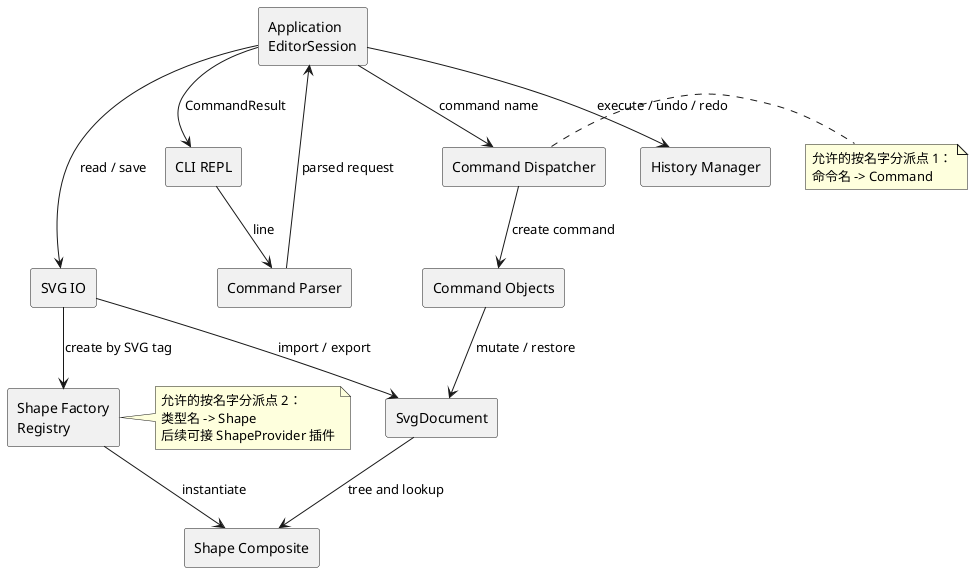

# SVG 编辑器（CLI）项目文档

本项目按照 `phase_cli_1.md` 实现一个基于 TypeScript、面向对象的 SVG 命令行编辑器。本文件是最终提交文档的工作版本，先确定架构基线；实现过程中如有必要，将在提交记录中迭代本方案。

## 架构方案

### 1. 总体目标与边界

程序提供 `svg>` 交互式 REPL，编辑一个 SVG 文档，并支持：

- `init`、`read`、`save`、`canvas` 文档操作；
- rect、circle、ellipse、line、text、g 六种内置图形的创建与属性编辑；
- `move`、`scale`、`set`、`delete`、`group`、`ungroup`、`addto`、`front`、`back`；
- `tree`、`show`、`help` 查询；
- 编辑命令的 undo/redo，以及 IO 命令后的历史锁定规则；
- 外部 SVG 缺少 id 时自动补 id 并输出 warning；
- 保存后可被浏览器直接打开，并能重新读回。

本阶段不实现 `box`。架构只为后续 ShapeProvider 插件预留注册边界，内核遇到 `box` 时输出 `error: unknown shape type: box (is the plugin loaded?)`。

### 2. 模块划分

代码按职责拆分为以下模块。每个类放在独立文件中，文件名与类名一致；模块内部通过接口和多态协作。

| 模块 | 目录 | 主要职责 | 允许感知的内容 |
|---|---|---|---|
| 领域文档 | `src/domain/document/` | `SvgDocument`、画布尺寸、根级图形集合、id 索引、父子关系和文档级约束 | SVG 文档语义；不感知终端和文件系统 |
| 领域图形 | `src/domain/shapes/` | `Shape` 抽象、叶子图形和 `GroupShape`；封装几何属性、公共属性、移动、缩放和子树遍历 | 图形语义与 Composite 操作 |
| 图形注册 | `src/shapes/` | 六种内置图形类、`ShapeFactory`、图形类型注册表和 SVG 属性映射 | 类型名到图形类的唯一工厂分派 |
| 命令 | `src/commands/` | `Command` 接口及每个编辑命令；保存执行前状态并实现 `execute` / `undo` | 领域对象和命令结果，不读写终端 |
| 应用编排 | `src/application/` | `EditorSession`、命令注册与分发、执行上下文、`HistoryManager`、结果状态和 undo/redo 规则 | 命令、领域文档、IO 服务 |
| 输入解析 | `src/cli/parser/` | 行拆分、双引号参数、`#` 注释、命令参数校验和 `in` 子句解析 | CLI 语法；不直接改变领域状态 |
| CLI 界面 | `src/cli/` | REPL 生命周期、`svg>` 提示符、输入输出和错误前缀格式 | 应用层返回的结构化结果 |
| SVG IO | `src/io/` | XML 读取、序列化、缺失 id 自动分配、文件读写错误转换 | 文档结构和图形工厂；不依赖 CLI |
| 测试 | `test/` | 领域、命令、IO、解析和 CLI 会话测试 | 被测公共接口 |

目标目录结构：

```text
src/
├── domain/
│   ├── document/
│   └── shapes/
├── shapes/
├── commands/
├── application/
├── cli/
│   └── parser/
└── io/
test/
doc/
└── README.md
```

### 3. 运行时协作流程

一次编辑命令的调用链如下：

1. `Repl` 读取一行输入；空行和 `#` 注释直接跳过。
2. `CommandParser` 将文本转成结构化参数，处理引号和数值格式。
3. `CommandDispatcher` 根据命令名创建对应的 `Command` 对象。
4. `EditorSession` 注入当前文档、`ShapeFactory` 和 IO 服务后执行命令。
5. 编辑命令成功后进入 `HistoryManager` 的 undo 栈，并清空 redo 栈；失败时不修改文档也不入栈。
6. 应用层返回 `CommandResult`，由 CLI 统一输出成功摘要或 `error:` 信息。

`tree`、`show`、`help` 返回展示结果但不进入历史栈；`init`、`read`、`save` 和带参数的 `canvas` 更新文档后锁定历史，直到下一次成功编辑命令重新允许 undo/redo。

### 4. PlantUML 组件图



### 5. 设计模式及落地方式

#### Command：编辑行为的统一撤销边界

`Command` 接口至少提供 `execute(context)`、`undo(context)` 和结果摘要。`CreateCommand`、`DeleteCommand`、`MoveCommand`、`ScaleCommand`、`SetAttributeCommand`、`GroupCommand`、`UngroupCommand`、`AddToCommand`、`ReorderCommand` 分别封装一种编辑行为。

每条编辑命令对应一个 undo 单元。命令在执行前保存必要的父节点、同级位置、旧属性或快照；执行失败时先完成校验再写入，确保状态保持不变。`GroupCommand` 即使移动多个图形，也只作为一个命令进入历史栈。

文档命令采用相同的应用入口，但实现为不可撤销操作：完成 IO 后由 `HistoryManager` 清空或锁定历史，符合需求中“undo not allowed after io command”的规则。

#### Composite：统一容器与叶子操作

`Shape` 是所有图形的共同抽象。叶子图形实现几何属性和属性白名单；`GroupShape` 持有有序子节点并递归实现 `move`、`scale`、`delete`、遍历和序列化。命令只依赖 `Shape` 接口，因此不会按标签写一套容器逻辑、再写一套叶子逻辑。

`group`、`addto` 和 `ungroup` 只改变树关系；`move` 与 `scale` 通过多态作用于整棵子树。`ungroup` 对普通 g 允许，对未来插件拥有内部语义的复合图形保留拒绝入口。

#### Factory / Registry：隔离类型创建与扩展

`ShapeFactory` 将 `rect`、`circle`、`ellipse`、`line`、`text`、`g` 映射到具体类，并提供注册接口。读入 SVG 时由同一个工厂创建节点，避免 IO 层直接实例化具体图形。未注册类型统一生成未知类型错误。

该注册表也是后续 `ShapeProvider` 的插槽：`box` 插件可以提供创建参数、子部件模板、`set` 传播和 `data-kind` 读回语义；内核不需要新增 `box` 分支。

#### Strategy：隔离输入、输出和属性策略

文件读写通过 `SvgReader`、`SvgWriter` 接口注入 `EditorSession`。缺 id 分配策略、属性格式化策略和输出格式策略分别封装，便于更换 XML 库、增加严格校验或改变序列化格式。当前只实现 SVG XML 策略，不为尚未需要的格式增加抽象层。

#### Facade：应用层的稳定入口

`EditorSession` 对 CLI 暴露稳定的执行入口，集中持有当前文档、工厂、IO 服务和历史管理器。CLI 不需要了解命令内部如何修改树；未来接入 GUI 或 HTTP 适配器时，可以复用同一应用入口。

### 6. 依赖方向规则

允许的依赖方向如下：

- `cli → application、cli/parser`：CLI 只处理交互和展示。
- `cli/parser → application`：解析器只构造结构化请求，不直接写文档。
- `application → commands、domain、io、shapes`：应用层负责组合依赖和生命周期。
- `commands → domain`：命令只通过领域接口完成编辑和恢复。
- `io → domain、shapes`：读写层把 XML 转为领域树或把领域树序列化为 XML。
- `shapes → domain`：具体图形实现领域抽象。
- `test → 任意生产模块`：测试只依赖被测公开接口。

以下依赖禁止出现：

- `domain` 不得依赖 `cli`、`application`、`io` 或具体命令类；
- `commands` 不得直接调用终端 API 或文件系统；
- `shapes` 不得依赖命令分发器；
- `io` 不得依赖 CLI 的文本输出格式；
- 具体图形不得通过全局变量查找文档或其他图形。

理由是把 SVG 语义和树操作留在核心，把终端、命令语法和文件格式放在边界；这样每一层都能独立测试，也能在不改领域模型的情况下替换交互界面或 XML 实现。

按名字分派只保留两个位置：命令分发器的“命令名 → Command 实现”和图形工厂的“类型名 → Shape 类”。这两处会在最终一致性检查中抽样确认，并作为未来可替换注册机制的明确变化点。

### 7. 变化点假设与预留取舍

1. **图形类型扩展**：最可能增加 box 等复合图形。预留 `ShapeFactory` 注册接口和 ShapeProvider 边界；本阶段不在核心命令中写 `box` 特判。
2. **命令语法扩展**：可能增加命令、别名、脚本或更严格的参数校验。预留 Parser 与 Command 分离；当前不为 GUI 手势设计另一套语法抽象。
3. **SVG 格式读写变化**：可能更换 XML 库、格式化策略或支持更多属性。隔离 `SvgReader`/`SvgWriter`；当前只覆盖需求规定的元素和白名单属性。
4. **撤销历史策略变化**：可能支持命令宏、历史持久化或更高效的快照。保留 Command 的执行/撤销边界和 `HistoryManager`；当前按单条命令保存恢复信息。
5. **交互渠道变化**：可能增加 GUI 或 HTTP API。由 `EditorSession` 返回结构化 `CommandResult`；当前不把展示字符串写入领域对象。
6. **文档规模变化**：未来可能处理更大的 SVG。当前先保证模型清晰和状态正确，不提前引入缓存、数据库或复杂增量索引；只有性能测试显示需要时再调整。

## 过程记录

本节只记录从已生成的文档或代码中发现的问题、确认方式和纠正动作。实现推进后按“问题 → 证据 → 修正”追加，不记录没有技术结论的流水账。

### 2026-10-26：初始化文档内容的校验

- **问题**：首次生成文档后通过 `Get-Content` 检查，发现 `doc/README.md` 实际为空，之前的写入命令没有把多行内容正确传入文件。
- **确认**：直接读取文件并检查 Git diff；提交中只有需求文档的新增内容，架构文档没有有效文本。
- **纠正**：改用补丁方式完整写入文档，并在提交前重新读取文件、检查 Git 状态和提交内容。

## 一致性自查

当前处于架构设计阶段，生产源码尚未开始实现。

1. **模块划分**：上述目录是实现基线，当前实际只有 `doc/` 和需求文档；源码开始后按小模块逐步建立。如目录职责发生变化，将在过程记录中写明原因，并同步修订本节。
2. **依赖方向**：当前没有生产代码依赖，暂不存在违反项。每完成一个模块检查 import 方向，最终提交前再抽样复核两个按名字分派点。

## 质量保证手段

实现阶段将采用以下证据确认完整性和质量：

- 对解析器、id 唯一性、图形属性、父子关系、Composite 移动/缩放和失败状态不变性编写测试。
- 对每个编辑命令验证“执行 → undo → redo”，覆盖 redo 清空、IO 后禁止 undo 和错误命令不入栈。
- 用含缺失 id、嵌套 g、文本和非法文件的 SVG 做读入测试，验证自动补 id 警告和错误前缀。
- 对保存结果做 XML 检查，再 read 回来比较画布、层级、属性和文本，验证 round-trip。
- 运行 TypeScript 类型检查、测试命令和典型 CLI 会话；每完成一个小模块先验证，再单独提交并推送。
