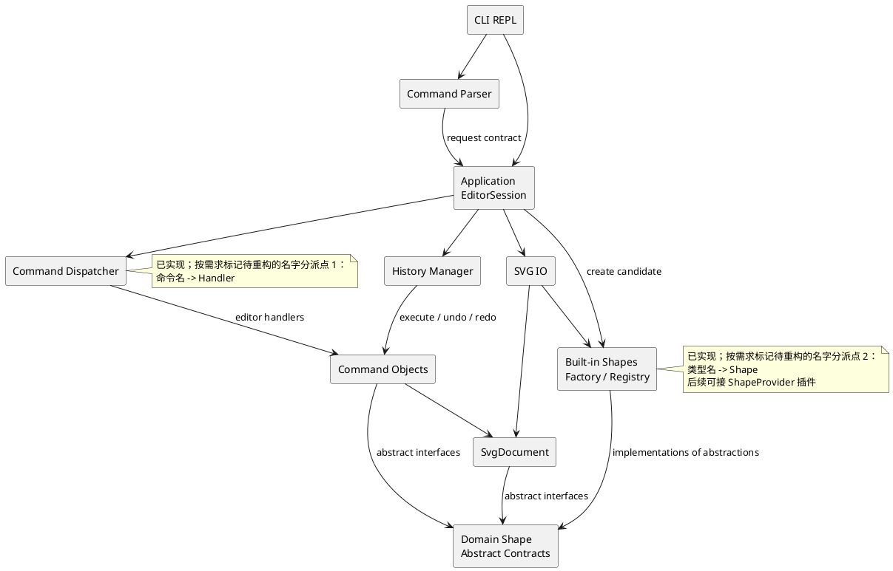

# SVG 编辑器（CLI）项目文档

本项目按照 `phase_cli_1.md` 实现一个基于 TypeScript、面向对象的 SVG 命令行编辑器。本文件汇总最终提交所需的架构方案、问题纠正过程、一致性自查及质量证据；版本仍可在用户确认前继续迭代，`final` 标签等待用户明确通知。

架构基线：2026-10-26，v1.1；实现与验收更新至阶段 7：2026-10-29。逐阶段实施、状态与验收见根目录 [DEVELOPMENT_PLAN.md](../DEVELOPMENT_PLAN.md) v1.1。Factory/Registry、EditorSession Facade、Create/Delete/Move/Scale/SetAttribute/Group/AddTo/Ungroup/ReorderCommand 和 HistoryManager 已落地，全部编辑、查询与历史命令已连接真实入口。SvgReader/SvgWriter 完成内存编解码，SvgFileStore 完成文件边界，read/save 接入会话、默认路径与成功后历史重置；canvas 与完整文档历史已验收，样例显示据用户截图确认。需求典型会话与流程图版本 A 已通过源码/编译入口；7B 交接证据及远程验收见开发方案第 8 节。

## 架构方案

### 1. 总体目标与边界

程序提供 `svg>` 交互式 REPL，编辑一个 SVG 文档，并支持：

- `init`、`read`、`save`、`canvas` 文档操作；
- rect、circle、ellipse、line、text、g 六种内置图形的创建与属性编辑；
- `move`、`scale`、`set`、`delete`、`group`、`ungroup`、`addto`、`front`、`back`；
- `tree`、`show`、`help` 查询；
- 编辑命令的 undo/redo，以及 IO 命令后的历史锁定规则；
- 外部 SVG 缺少 id 时自动补 id 并输出 warning；
- 保存后可被浏览器直接打开，并能重新读回。

本阶段不实现 `box`。架构只为后续 ShapeProvider 插件预留注册边界，内核遇到 `box` 时输出 `error: unknown shape type: box (is the plugin loaded?)`。

### 2. 模块划分

代码按职责拆分为以下模块。每个类放在独立文件中，文件名与类名一致；模块内部通过接口和多态协作。

| 模块 | 目录 | 主要职责 | 允许感知的内容 |
|---|---|---|---|
| 领域文档 | `src/domain/document/` | `SvgDocument`、画布尺寸、根级图形集合、id 索引、父子关系和文档级约束 | SVG 文档语义；不感知终端和文件系统 |
| 领域图形 | `src/domain/shapes/` | `Shape`、`ContainerShape` 等抽象契约；封装公共属性、几何操作和子树遍历接口 | 图形语义与 Composite 操作 |
| 图形注册 | `src/shapes/` | 六种内置图形类、`ShapeFactory`、图形类型注册表和 SVG 属性映射 | 类型名到图形类的唯一工厂分派 |
| 命令 | `src/commands/` | `Command` 接口及每个编辑命令；保存执行前状态并实现 `execute` / `undo` | 领域对象和恢复状态，不读写终端 |
| 应用编排 | `src/application/` | `EditorSession`、命令注册与处理器、参数验证、`HistoryManager`、结果和 tree/show 格式化 | 命令、领域文档、工厂、IO 服务 |
| 输入解析 | `src/cli/parser/` | 通用词法解析：行拆分、双引号、整行注释；返回保留引号来源的词元 | 不按命令名或类型名二次分派，不改变领域状态 |
| CLI 界面 | `src/cli/` | REPL 生命周期、`svg>` 提示符、输入输出和错误前缀格式 | 应用层返回的结构化结果 |
| SVG IO | `src/io/` | XML 读取、序列化、缺失 id 自动分配、有界文件适配和错误转换，以及外部解析禁用和输入资源限制 | 文档结构和图形工厂；不依赖 CLI |
| 测试 | `test/` | 领域、命令、IO、解析和 CLI 会话测试 | 被测公共接口 |
| 组合根 | `src/main.ts` | 实例化依赖、注册内置命令和图形、注入 IO、启动 REPL | 可依赖各模块用于装配 |

六种具体类型（含 `GroupShape`）只放在 `src/shapes/`，避免领域抽象与具体类重复归属。`SvgDocument` 持有领域抽象，负责统一维护树与索引；具体类不反向调用工厂。

阶段 3A 建立的结构基础：`SvgDocument` 是父子关系的唯一事实来源，Shape 不重复保存 parent/children；通过 `parentOf`、`childrenOf` 和 `walk` 查询，返回冻结的顺序快照。`insert`/`insertSubtree` 完整校验候选后才加入索引和树；`remove` 摘除整棵子树并返回冻结的 `ShapeSubtree` 拓扑，保留原 Shape 实例供恢复使用，不将其当作几何属性快照。命令恢复原位置时另行保存父节点和同级索引。跨文档的同一 Shape 实例在摘除前不得重复挂接；不同文档可以各自使用相同 id 的不同实例。4B 已接入子树移动/缩放及精确恢复，4C 接入受控属性修改；5A 补充受控拓扑准备与恢复。

阶段 3C 的查询实现：具体图形覆写 `Shape.geometry`，基类 `attributes` 合并显式公共样式，返回冻结的属性快照；GroupShape 沿用空几何视图。`DocumentFormatter` 只依赖领域抽象，迭代读取文档关系并生成 tree/show；不按 type/tag 判断具体几何。两种查询使用规范属性名，show 从 `parentOf` 读取真实父节点，根级显示 parent=svg。文本与有特殊字符的值转义为单行，原属性不变。它是应用层格式化职责，不新增 Strategy 模式。

阶段 4B.1：DeleteCommand 通过 SvgDocument.remove 摘除子树，保存冻结拓扑、原父 id 和原同级索引；undo 使用 insertSubtree 完整校验后恢复原实例。EditorSession 生成删除/恢复摘要，HistoryManager 将整棵子树作为一个历史单元；根级恢复显示 restored into svg，组内显示 restored into g#id。失败恢复不推进命令状态，修复冲突后可重试。

帮助同源：`CommandDispatcher` 的注册项同时保存处理器与必填语法回调；create 的回调枚举 `ShapeFactory` 同一类型表的 CLI 语法，内置语法直接由已有 schema 生成。回调在查询时求值，后注册的 CLI 类型也能显示，不执行参数解析或构造。扩展注册可同时提供 CLI parser 与语法；无 CLI parser 的内部类型不显示创建帮助。help 未初始化可用，当前列出全部 19 个已实现命令及六种创建语法。

实际目录结构（与方案一致）：

```text
src/
├── domain/
│   ├── document/
│   └── shapes/
├── shapes/
├── commands/
├── application/
├── cli/
│   └── parser/
├── io/
└── main.ts
test/
doc/
└── README.md
```

### 3. 运行时协作流程

一次编辑命令的调用链如下：

1. `Repl` 读取一行输入，由 `CommandParser` 跳过空行及整行注释；参数中的颜色 `#ffffff` 正常保留。
2. `CommandParser` 只产生词元请求并保留 quoted 信息，不负责按命令名或图形标签分派。
3. `EditorSession` 调用 `CommandDispatcher` 查找唯一命令注册项，由该项校验参数；create 通过 `ShapeFactory` 的类型注册项解析几何参数和尾部 `in`。
4. 应用处理器调用工厂构造未挂接的候选 Shape，再传给 `CreateCommand`；编辑命令只操作领域对象。read/save 等文档处理器在应用层调用 IO，不把 IO 注入编辑命令。
5. 编辑命令成功后进入 `HistoryManager` 的 undo 栈，并清空 redo 栈；失败时不修改文档也不入栈。
6. 应用层返回 `CommandResult`，由 CLI 统一输出成功摘要或 `error:` 信息。

`tree`、`show`、`help` 和无参数 `canvas` 不改变历史。成功的 `init`、`read`、`save` 和带参数 `canvas` 清空旧栈并设置 IO 锁定标记；undo/redo 报需求指定错误。下一次成功编辑建立新的历史并解除锁定；失败编辑和失败 IO 保留原文档、路径与历史。

`HistoryManager` 只在操作成功后移动栈项；撤销后只有新成功编辑会清空 redo。read 使用临时文档，save 先完整生成内容并写同目录临时文件，最终替换成功后才更新路径与历史。

6B.2 的 `CommandHandler`、`CommandDispatcher.dispatch` 和 `EditorSession.execute` 返回 `CommandResult | Promise<CommandResult>`，同步编辑/查询保持原行为，REPL 统一 await。Facade 对同步异常和异步拒绝统一生成错误结果；异步命令未完成时，重叠调用返回 `command in progress. wait for completion`，不额外排队或按名字分派，完成或失败后释放。正常 REPL 本身逐条执行；此约束只防止通过应用入口交错操作，不支持直接持有领域对象并发修改。

当前实际流程为 `main.ts → Repl → CommandParser → EditorSession → CommandDispatcher → CommandResult → TerminalOutput`。`CommandRequest`、`CommandToken` 和 `CommandExecutor` 属于应用层边界契约；Parser 返回 skip/error/command，保留参数的值、顺序与 quoted 信息。REPL 对每行原文调用 Parser，词法错误只呈现，不调用执行器。EditorSession Facade 已接入 init/read/save/canvas/create/delete/move/scale/set/group/addto/ungroup/front/back/tree/show/help/undo/redo，命令名由 CommandDispatcher 唯一分派；候选文档构造成功后才替换当前文档并重置历史。ShapeFactory 同一注册项保存创建函数、CLI 参数规则与 SVG 属性转换；按必填参数、可选样式、尾部未加引号 in 的顺序解析 CLI。CreateCommand 保存图形实例、父 id 和首次同级位置，DeleteCommand 保存完整子树及原位置，MoveCommand/ScaleCommand 保存已校验的几何前后状态，SetAttributeCommand 保存属性状态，GroupCommand/AddToCommand/UngroupCommand/ReorderCommand 保存受控拓扑变更；HistoryManager 调用 execute/undo，领域接口恢复实例、拓扑或数值。应用层生成成功及恢复摘要。查询和失败请求保留历史；undo/redo 先验证文档、参数，再检查锁定和空栈。6A 内存 Reader/Writer 与 6B 文件适配、会话接线已实现，6C 已实现 canvas 查询/修改及完整文档历史自动化回归。

### 4. PlantUML 组件图

下图展示模块依赖，运行时返回值不另画反向依赖；组合根 `src/main.ts` 负责创建具体实现并装配。



### 5. 设计模式及落地方式

#### Command：编辑行为的统一撤销边界

`Command` 的实际接口为 `execute(): void`、`undo(): void`；文档、目标图形等依赖在构造命令时注入，不再传入 context，也不向命令接口加入终端摘要。redo 对同一命令对象再次调用 execute。`CreateCommand`、`DeleteCommand`、`MoveCommand`、`ScaleCommand`、`SetAttributeCommand`、`GroupCommand`、`AddToCommand`、`UngroupCommand`、`ReorderCommand` 已实现这一接口。

成功摘要由应用层处理器依据已验证参数和目标对象生成，并转换为 `CommandResult`；CLI 只负责统一呈现。阶段 4A 的 HistoryManager 保存命令及应用层提供的撤销/重做反馈，操作成功后才返回相应反馈；不让 commands 反向依赖应用层结果、终端或历史。领域恢复由命令负责，历史层不按命令名判断摘要或操作。

4A 已实现 `HistoryManager.execute(command, feedback)`、`undo()`、`redo()` 与 `resetAfterIo()`，并接入 EditorSession。反馈在执行前复制并冻结；执行成功才入 undo 栈、清空 redo 并解除 IO 锁定，undo/redo 成功才移动栈顶。成功 init/read/save/canvas 修改已复用该接口重置两栈并锁定；canvas 查询不改变历史。历史管理器不修复命令的部分写入，`Command` 契约要求失败时领域状态不变。撤销 create 输出 `类型#id removed`，重做复用首次创建摘要（含父容器）。

每条编辑命令对应一个 undo 单元。从首次接入 create 开始就走 Command 路径，不先实现一条绕过历史的直接编辑路径。命令保存父节点、同级位置、旧属性或封装快照；先验证完整候选结果再写入。move/scale 恢复旧几何值，不仅使用逆运算，以免浮点误差积累；redo 复用保存结果。`GroupCommand` 即使移动多个图形，也只作为一个命令进入历史栈。

文档操作采用相同的应用入口，由应用层文档处理器负责，编辑 Command 不持有 IO 服务。只有成功的文档操作清空历史并锁定，符合需求中“undo not allowed after io command”的规则。

6C.1 的 `SvgDocument.resize(width, height)` 完整校验后同步尺寸和 `viewBox=0 0 w h`，不改图形树、局部属性和根元数据。Facade 登记 `canvas [w] [h]`：无参只查询，修改必须同时给两个正有限数；成功修改（含同尺寸）重置历史并保留默认路径，失败保留全部会话状态。它是文档操作，不创建可撤销 Command。

#### Composite：统一容器与叶子操作

`Shape` 是所有图形的共同抽象，`ContainerShape` 提供容器契约，`GroupShape` 是具体实现。4B 的统一几何操作由 `SvgDocument` 按唯一拓扑迭代汇总各 Shape 的本地准备结果：叶子经 `GeometryShape` 校验坐标/尺寸，容器本地为空操作，子孙各处理一次。整个子树准备成功后才应用 `GeometryChange`，避免递归调用栈及中途失败造成部分修改。GroupShape 不另存 children；命令无需区分容器与叶子。4C 的 attributeType/prepareSet 多态接口分别提供属性类型白名单和已校验的本地 AttributeChange；公共样式由 Shape 处理，数值几何沿用 GeometryShape 的坐标轴/尺寸声明，TextShape 补充 text。领域接收 number/string，不负责 CLI 数字转换。SetAttributeCommand 保存前后状态，撤销缺省样式时恢复 undefined，使属性重新缺失，不写入渲染默认值；容器属性不传播。删除和重组通过统一子树接口维护索引与归属。XML 生成仍位于 IO 层。

`GeometryChange` 封装已校验的前后状态及只赋值的 apply/restore；准备阶段允许失败但不得修改模型，应用/恢复阶段不得抛错。`GeometryCommand` 使用局部 **Template Method**：固定快照保存与执行/恢复生命周期，MoveCommand/ScaleCommand 只覆写准备钩子，redo 重用保存结果。数值视图冻结，文字和样式不参与运算；scale 乘全部坐标和尺寸，文本仅有 x/y 数值，不扩大字体，stroke-width 不变。有限下溢为零可接受，非有限结果拒绝；极小倍数的撤销同样恢复原值，不依赖除法。扩展 Shape 未实现相应准备时明确拒绝，不能静默跳过；扩展若提供该接口，也必须遵守上述契约，本阶段不承诺任意插件的事务隔离。

5A 的 `SvgDocument.prepareGroup`、`prepareAddTo` 返回 `TreeChange`，只捕获受影响记录和必要的根顺序，前后拓扑封装在文档内部闭包。每次 apply/restore 先验证预期实例、关系、归属及最终父链无环，全部通过后统一写入；失败不推进命令状态，冲突消除后可重试。GroupCommand/AddToCommand 缓存同一变更，undo/redo 精确恢复原父节点、同级顺序和实例，不重新解析输入。同父 group 占最早选中位置，跨父 group 放根末尾，孩子按操作前文档顺序；addto 放目标最后位置，同父也移到末尾。两者均不修改本地几何、样式或文本，重新归属可能改变继承后的呈现。反馈仍由应用层生成并由历史项冻结保存。

5B 的 `SvgDocument.prepareUngroup` 同样返回 TreeChange，将嵌套组的直接孩子按原顺序替换组所在同级位置；更深子树保持原结构。ContainerShape 的 `canUngroup` 默认 false，普通 GroupShape 显式覆写为 true；按能力校验后检查顶层限制，不根据 type 名判断或在领域引用具体 GroupShape。空嵌套组可以解散；UngroupCommand 保存同一变更，undo 恢复原组实例、属性、父关系和位置，redo 重用保存结果。所有本地属性保持原值，不补偿移除组造成的继承变化；冲突失败不写入且可重试。应用层按直接孩子数生成 `类型#id ungrouped; N children promoted into 类型#原父`，undo 为 `类型#id restored with N children`，身份转义与查询保持一致。

5C 的 `SvgDocument.prepareReorder(id, position)` 返回 TreeChange，`front` 对应 end，`back` 对应 start。只调整原父的同级序列（含 svg 根），目标记录同时参与对象身份校验；不摘除子树、不改变 parent、属性或后代顺序。ReorderCommand 缓存前后拓扑，undo 精确恢复位置，redo 不重新计算；边界位置与唯一同级仍作为一次成功编辑并清空 redo。应用层显式登记两个命令并注入方向、语法和反馈，共用处理器，不读取命令名再次分派。成功/重做为 `类型#id brought to front` / `sent to back`，撤销为 `类型#id sibling order restored in svg` 或实际父身份；反馈由应用层生成，HistoryManager 保存。

`group`、`addto`、`ungroup` 改变树关系；front/back 改变同级绘制顺序；move/scale 通过多态作用于子树。g 的 set 修改容器自身样式，保留 SVG 继承语义，不覆盖后代显式样式。普通 g 只有在嵌套时允许 ungroup，顶层 g 必须拒绝；未来插件的内部复合图形可通过容器能力契约拒绝解散。

#### Factory / Registry：隔离类型创建与扩展

`ShapeFactory` 将 `rect`、`circle`、`ellipse`、`line`、`text`、`g` 映射到具体类，并提供注册接口。读入 SVG 时由同一个工厂创建节点，避免 IO 层直接实例化具体图形。未注册类型统一生成未知类型错误。

注册项同时提供 CLI 参数与 SVG 元素构造入口，所有类型名查找集中在同一工厂。当前预留注册边界，后续可扩展为 `ShapeProvider` 的模板、set 传播和 data-kind 读回能力；本阶段不实现完整插件协议，也不新增 box 分支。

#### IO 隔离：按实际变化需求预留接口

`SvgReader.read(source)` 返回完整临时文档与只读 warning 列表；`SvgWriter.write(document)` 返回 XML 字符串，两者不访问文件、不操作历史。`SvgFileStore.read(path)` 异步返回严格 UTF-8 字符串，按实际读取字节数限制 5 MiB，并最多多读一个判界字节；`write(path, source)` 独占创建同目录唯一临时文件，写完、同步并关闭后 rename 替换，失败清理临时文件；替换原子性受目标文件系统语义约束。`SvgFileError` 保留 read/write/resource-limit、原路径和 cause；应用层把文件/解析/资源错误统一转换为规定的 cannot read file，把序列化/写入错误转换为 cannot write file，cause 保留底层错误。文件适配器不持有文档或历史，写入与替换函数可注入以验证失败边界。当前 id 分配和格式化只有单一规则，不额外拆 Strategy。

`main.ts` 显式注入 ShapeFactory 与 SvgFileStore；EditorSession 通过文件读写方法的结构接口隔离依赖，Reader 复用同一工厂。read 成功才发布候选文档、默认路径和 warnings；save 完成目标替换后才更新默认路径并重置历史。read/显式 save 成功记录原路径，后续无参 save 复用它；init 成功清空路径。相对路径沿用进程工作目录，无默认路径时使用方案规定错误。`filePath` 只读查询会话路径；所有失败保留原文档、路径及历史。文件命令不作为可撤销 Command，Facade 继续负责成功摘要和实际元素计数（含 g 与子孙、不含 svg）。

Reader 使用 saxes 的严格事件解析，在 opentagstart 限制总数和深度，拒绝 DTD/DOCTYPE、自定义实体及处理指令，不安装外部解析器。先预留包括根在内的全部显式 id，再按类型计数补全并跳过占用项；完整成功才返回 warning。通过原有 ShapeFactory 注册项构造六种图形，不按标签另设分派。SvgReadError 保留 invalid-xml/unsupported-svg/resource-limit 类别，6B 再映射为带路径的规定错误。输入上限为 5 MiB UTF-8、128 层（含根）及 50,000 元素（含根）；边界与不解析外部资源均有测试证据。

领域只承载 SVG 语义：Shape 封装附加属性并提供 svgAttributes/textContent 多态视图，TextShape 区分子文本与同名附加属性；SvgDocument 保存独立 viewBox 和根元数据，并在插入/分组时保留根 id。Writer 迭代读取统一树接口，保留层级顺序、缺省样式和附加属性，正确转义实体与 XML 空白；xmlchars 校验名称/字符，saxes 校验最终命名空间。Reader 将带前缀属性所需声明固化到节点本地，保证重组后可写。

读入仅支持六种图形及根 svg，几何为有限无单位数值；transform/字体等附加属性保留而不计算，未知元素明确拒绝，注释及原格式不保留。读写不承诺完整 SVG/CSS 引用系统或内容净化；保留的事件、URL/CSS 属性在浏览器中的行为不属于解析器的外部资源禁用范围。输入预算也不保证任意编辑扩大后的输出都能重新读入。CLI read/save、路径上下文与对应 IO 历史已在 6B.2 接入；6C 已接入 canvas 与完整文档历史回归，样例视觉证据已由用户提供的打开截图补齐（见质量保证）；不宣称自动操作浏览器或跨浏览器验证。

#### Facade：应用层的稳定入口

`EditorSession` 对 CLI 暴露稳定的执行入口，集中持有当前文档、工厂、IO 服务和历史管理器。CLI 不需要了解命令内部如何修改树；未来接入 GUI 或 HTTP 适配器时，可以复用同一应用入口。

### 6. 依赖方向规则

允许的依赖方向如下：

- `cli → application、cli/parser`：CLI 只处理交互和展示。
- `cli/parser → application`：解析器只构造结构化请求，不直接写文档。
- `application → commands、domain、io、shapes`：应用层负责组合依赖和生命周期。
- `commands → domain`：命令只通过领域接口完成编辑和恢复。
- `io → domain、shapes`：读写层把 XML 转为领域树或把领域树序列化为 XML。
- `shapes → domain`：具体图形实现领域抽象。
- `test → 任意生产模块`：测试只依赖被测公开接口。
- `main.ts → 上述模块`：组合根负责实例化和注册，是明确的装配依赖例外。

以下依赖禁止出现：

- `domain` 不得依赖 `cli`、`application`、`io` 或具体命令类；
- `commands` 不得直接调用终端 API 或文件系统；
- `shapes` 不得依赖命令分发器；
- `io` 不得依赖 CLI 的文本输出格式；
- 具体图形不得通过全局变量查找文档或其他图形。

理由是把 SVG 语义和树操作留在核心，把终端、命令语法和文件格式放在边界；这样每一层都能独立测试，也能在不改领域模型的情况下替换交互界面或 XML 实现。

按名字分派只保留两个位置：命令分发器的“命令名 → 处理器”和图形工厂的“类型名 → Shape 类”。两处均标注为**待重构点**：本阶段集中注册已足够，未来再评估动态注册发现机制。Parser、IO 和 tree/show 不得另设同类分派。

### 7. 变化点假设与预留取舍

1. **图形类型扩展**：最可能增加 box 等复合图形。预留 `ShapeFactory` 注册接口，后续再扩展为完整 ShapeProvider；本阶段不在核心命令中写 `box` 特判。
2. **命令语法扩展**：可能增加命令、别名、脚本或更严格的参数校验。预留 Parser 与 Command 分离；当前不为 GUI 手势设计另一套语法抽象。
3. **SVG 格式读写变化**：可能更换 XML 库、格式化策略或支持更多元素。隔离 `SvgReader`/`SvgWriter`；set 仅接受白名单，读入则保留六种支持节点上的附加普通属性和根 viewBox。transform 保留而不展开，未知图形标签明确拒绝；具体边界见开发方案，不承诺完整 SVG/CSS 引擎。
4. **撤销历史策略变化**：可能支持命令宏、历史持久化或更高效的快照。保留 Command 的执行/撤销边界和 `HistoryManager`；当前按单条命令保存恢复信息。
5. **交互渠道变化**：可能增加 GUI 或 HTTP API。由 `EditorSession` 返回结构化 `CommandResult`；当前不把展示字符串写入领域对象。
6. **文档规模变化**：未来可能处理更大的 SVG。当前先保证模型清晰和状态正确，不提前引入缓存、数据库或复杂增量索引；只有性能测试显示需要时再调整。

## 过程记录

本节只记录从已生成的文档或代码中发现的问题、确认方式和纠正动作。实现推进后按“问题 → 证据 → 修正”追加，不记录没有技术结论的流水账。

### 2026-10-26：初始化文档内容的校验

- **问题**：首次生成文档后通过 `Get-Content` 检查，发现 `doc/README.md` 实际为空，之前的写入命令没有把多行内容正确传入文件。
- **确认**：直接读取文件并检查 Git diff；提交中只有需求文档的新增内容，架构文档没有有效文本。
- **纠正**：改用补丁方式完整写入文档，并在提交前重新读取文件、检查 Git 状态和提交内容。

### 2026-10-26：审查生成的开发建议与架构基线

以下只记录本次从生成方案和既有文档发现的问题及修正，不将计划中的功能写成已经实现。证据来源为开发建议的阶段安排、本文原架构和需求 2.1、3、4.1—4.3。

| 发现的问题 | 确认依据 | 修正方式 |
|---|---|---|
| init 排在 IO 阶段，create 又先于 Command | 原建议第三阶段验收 CLI create，第六阶段才实现 init，第四阶段才引入 Command；当前文档前置条件和编辑路径不成立 | 阶段 3 提前接入 init，首个 create 就封装 Command；History 在阶段 4 扩展 |
| 领域和具体图形重复归属 | 原模块表同时在 domain/shapes 和 shapes 放叶子及 GroupShape | domain 只放图形抽象；六种具体类型及工厂放 shapes，同步修订模块表与图 |
| Parser 和工厂可能各建类型分发表 | 原 Parser 职责含所有命令参数和 in；需求 2.1 限定两处分派 | Parser 仅处理词元，命令注册项校验命令参数，工厂注册项校验类型参数；统一供 CLI 与 SVG 读入使用 |
| 编辑命令接收 IO 与只依赖 domain 冲突 | 原协作流程向命令注入工厂和 IO，但依赖规则只允许 commands → domain | 应用层先构造候选 Shape；CreateCommand 只接收领域对象；文档处理器在应用层调用 IO，明确组合根装配例外 |
| 单一实现仍拆 Strategy，且插件承诺超出阶段 | 原文列出 id/格式化多种策略并暗示完整 box 插件协议已可使用，实际本阶段未实现 | 保留 Reader/Writer 与注册边界，取消额外 Strategy；完整 ShapeProvider 留待后续 |
| 普通 g 的 ungroup 描述缺少顶层限制 | 原文称普通 g 允许解散，而需求 4.2 禁止顶层 g 解散 | 修订 Composite 描述，并把顶层拒绝、嵌套提升、原位恢复加入阶段 5 验收 |
| 仅校验异常不足以证明失败状态不变 | 需求要求失败不改任何状态，原建议没有覆盖历史、路径、多节点和中途溢出 | 补充完整候选验证、旧几何状态恢复、临时文档与文件替换；测试比较文档和后续历史行为 |
| 缺 id 补全可能撞上文件后部已有 id | 需求同时要求自动补 id 和全局唯一，原建议未给冲突算法 | 先收集显式 id，再跳过占用值生成；重复显式 id 拒绝，阶段 6 加入 fixture |
| #、in、g set 与外部属性的边界不清 | 参数有 # 颜色与引号文本，set 白名单不等于读入可丢弃额外属性；原建议未规定处理方式 | 执行方案区分明确需求与默认决策，补充词法、继承、scale、transform 和未知元素测试边界 |
| 阶段较大，验收未覆盖完整架构约束 | 基础编辑阶段含多个命令和历史，容易大提交；最终检查缺少实际 import 和模式证据 | 拆分 3A—6C 等提交点，模块完成即反馈并 push；最终自查必须引用实际文件和验证结果 |

此次形成根目录 `DEVELOPMENT_PLAN.md` v1.0，并将架构修订为 v1.1。尚未实现生产代码，默认语义及测试计划将在对应阶段落地验证。

### 2026-10-27：复核执行体系审核并补齐交付门槛

本次根据审核意见重新检查自己生成的 `DEVELOPMENT_PLAN.md` v1.0、根 README 和本文，确认以下缺口真实存在，采纳四项主要建议。它们补充执行与交付要求，不改变模块和设计模式；尚未将 CI 或输入限制实现为代码。

| 发现的问题 | 确认依据 | 纠正方式 |
|---|---|---|
| 阶段复选框只有完成/未完成，且开头状态描述会过时 | v1.0 第 8 节只有 15 个勾选项，没有进行中、验收证据、实现 SHA、CI 或阻塞记录 | 改为五态进度表和阶段记录模板；完成需验收、推送和该实现提交的 CI 证据。反馈持续说明已完成、证据、阻塞和下一步 |
| 记录 SHA 容易形成自引用，审核意见未说明如何维护 | 如果把记录文件所在提交的 SHA 写入文件，修改文件又会产生新 SHA | 实现提交验收后用独立小文档提交记录其 SHA；记录提交自身的 push/CI 在阶段报告核实，最终 tag 仍需指向通过检查的最终提交 |
| 使用者交付缺少根 README | 根 README 只有项目标题，v1.0 阶段 7 关注课程验收但没有使用说明清单 | 阶段 1 先交代环境与可用入口，阶段 7 完成交接：安装、启动、示例、预览、SVG 范围、限制和文档链接；保持课程/个人工具定位，不增加 npm 发布流程 |
| 本地检查无法保证后续提交重复通过 | v1.0 有 typecheck/build/test，但无 Node/npm 基线、CI 和格式门槛 | 采用 Node.js 24 LTS，在阶段 1 确定 npm 主版本；加入 Windows/Linux push/PR CI、npm ci 和 Prettier 检查，不设置任意覆盖率目标 |
| CI 成功不能自动等同全部验收 | 提示符、实际浏览器显示和架构抽样不完全被自动化任务覆盖 | 精确记录 CI 对应 SHA 与链接，并保留交互/浏览器手工证据；不默认修改分支保护配置 |
| SVG 读入缺少外部实体与解析期间资源限制 | v1.0 规定临时文档和失败恢复，但未禁 DTD/外部资源，也未限制输入大小、深度和节点数 | 阶段 6 选库时验证并禁用外部解析；初始预算 5 MiB、128 层、50,000 元素，解析期间检查，边界与超限测试通过后落实到实现和 README |
| 资源限制值与安全承诺需要限定 | 审核建议值按库能力确定；仅限制 XML 不会消除保留属性中的浏览器行为 | 将限值标为待阶段 6A 验证的初始预算，调值须有证据；不把读写器宣传为 SVG 净化工具，也不声称已安全处理任意外部 SVG |

修订结果：根开发方案 v1.1，新增持续状态与证据记录、使用者交付清单、仓库级门槛及 XML 输入边界。所有实现阶段仍为未开始，当前无生产代码测试或 CI 通过证据。

### 2026-10-27：工程和 REPL 实现中的问题校验

| 发现的问题 | 确认依据 | 纠正方式 |
|---|---|---|
| 初选测试框架版本带入已知漏洞，镜像源不能提供有效审计 | 安装 Vitest 3 后在 npm 官方源执行 audit，报告 3 项漏洞（1 moderate、2 critical）；本地镜像源的 audit 接口返回 404，不能作为无漏洞证据 | 更新至 Vitest 4.1.12，使用官方源生成锁文件并重新安装、审计，结果为 0 漏洞；不将镜像源审计不可用写成通过 |
| 工程骨架允许没有测试仍成功，且类型检查只覆盖源码 | 检查生成的脚本发现 `--passWithNoTests`；tsconfig 只包含 src，测试中的类型错误可能不被 tsc 检出 | 加入真实输入循环和入口测试后移除空测试放行选项；增加 tsconfig.test.json，typecheck 同时检查 src 与 test |
| 首次 CI 在 Windows 格式检查失败，Linux 成功 | `a65140f` 的 CI 40461811313 中 Windows 的 format:check 失败、后续检查跳过，Linux 成功；尚未获取原始失败日志，按平台换行差异假设修正并重跑 | 独立提交 `9ca1c8a`，通过 .gitattributes 固定文本 LF、Prettier 显式 endOfLine=lf；CI 40462330364 在 Windows/Linux 均通过，确认该修正消除了跨平台格式失败，不据此断言已读取失败日志 |
| REPL 的关闭状态和提示符实现没有覆盖提前 EOF | 首次访问非公开的 reader.closed 导致 TS2551；改用无条件 prompt 后，预缓冲输入的 4 项测试报 `readline was closed`，证明 EOF 到达时仍可能有待处理行 | 用公开 close 事件记录关闭；真实终端仅在未关闭时调用 prompt，管道独立写提示符并继续消费队列。加入空 EOF、末行无换行、异步顺序测试；10 项测试及 Windows 真实终端 Ctrl+D 验收通过 |
| 文档仍称“没有生产代码”和“REPL 未实现” | 对照新增 src/cli、应用结果契约和 2 个测试文件，根 README 与一致性自查已经过时 | 同步当前可用行为、暂不支持的业务命令、实际依赖和验收证据；保留以日期标记的旧审查结论作为历史，不把计划模式写成已落地 |

### 2026-10-27：复核阶段一测试覆盖建议

两项建议均采纳，属于回归证据补强，不是已确认的运行缺陷。检查自己生成的 `Main.test.ts`，仅有 tsx 源码子进程测试；REPL 测试将异步执行顺序和输入流失败分开验证，没有交叉场景，手工补查无法持续防止回归。

- **编译入口**：将入口测试参数化，同时启动源码与 `dist/main.js`，断言欢迎语、过滤、错误及 EOF 退出。增加 npm 的 pretest 构建钩子，确保本地 `npm test` 和 CI 都先重新构建，不依赖遗留 dist；CI 的独立构建步骤并入该钩子，避免重复构建。
- **异步中输入失败**：用受控 Promise 确保执行器尚未完成，再销毁输入流，确认错误事件已发生后才释放执行器；断言 REPL 最终拒绝原输入错误且没有多次执行。验证通过，无需修改 REPL 生产逻辑；不以计时 sleep 制造竞态。
- **结果**：2 个测试文件、12 项测试通过（原 10 项全部保留，新增编译入口和交叉场景各 1 项）。推送与 CI 证据在开发方案中追加。

### 2026-10-27：Parser 边界与生成测试的校验

- **问题**：生成方案要求保留 quoted 标记，却未规定部分引号拼接时的含义；同时阶段 2 写“测试注册项契约”，阶段 3B 才引入分派注册项，容易提前增加占位框架。
- **确认**：对照开发方案阶段 2/3B 和 `in` 必须为尾部未加引号子句的约束；`"in"suffix` 若接受拼接，将无法仅用布尔标记表达整词来源。
- **修正**：双引号只包裹完整词元，拼接报受控词法错误；Parser 对未知命令、类型、非法数值和参数数量不做语义判断。阶段 2 建立只读请求与执行器契约，注册项与语义测试明确随阶段 3B 实现。
- **生成测试问题**：末尾反斜杠 fixture 最初使用 raw 模板字符串，反斜杠转义了模板结束符，Prettier/Vitest 均报告未闭合字符串，尚不能验证 Parser。改为显式转义的普通字符串后，24 项词法测试和原 12 项回归全部通过；不将测试文件的语法错误误认为解析器缺陷。

### 2026-10-27：复核图形工厂的扩展边界

- **问题**：生成的扩展 specification 使用任意字符串类型，可能以 `g` 等内置名字携带扩展 properties；原工厂直接断言类型，且未验证扩展回调返回的节点身份。扩展回调若返回其他 id/type，会破坏后续文档索引和序列化的一致性。
- **确认**：检查 `ShapeCreationSpecification` 的联合类型与注册表调用边界，新增内置名字扩展 payload、覆盖内置注册、返回错误 id/type 的测试。
- **纠正**：保留唯一类型注册表；内置与扩展构造数据入口互斥，重复注册拒绝且不替换原项，构造结果核对 id/type。接口命名为 `register`，仅承诺未来类型扩展点，不将其描述为已实现插件加载协议。六种内置构造器校验有限几何值及非负尺寸/描边宽度。
- **阶段边界复核**：只读 getter 是字段封装，并不要求采用不可变对象替换策略；几何运算与受控状态恢复仍随阶段 4B/4C 引入。当前不提前实现编辑命令，也不把图形构造验收冒称为 Composite 移动/缩放验收。

### 2026-10-27：真实入口接线后的文档一致性校验

- **发现**：接入 EditorSession/init 后，根 README 和架构运行流程仍宣称真实入口只返回阶段占位错误，与新代码及入口测试不符。
- **确认**：对照 main.ts 的实例化、EditorSession 的 init 注册以及源码/编译入口子进程输出，确认已能创建画布；create、历史与 IO 此时尚未接入。
- **修正**：同步欢迎语和当前接线与功能边界，保留未实现能力的说明。验收用真实入口断言成功摘要，避免只有注入的假执行器测试通过。

### 2026-10-27：create 参数边界与可扩展接线校验

- **发现**：最初生成的工厂 CLI 适配器只返回 specification，把 parentId 固定为 null；若继续在 EditorSession 扫描 in，则既会丢失嵌套语义，也会把类型参数知识移出注册项。另一个数值隐患是 Number(空字符串/纯空白) 得到 0，可绕过“非数值拒绝”的意图。
- **确认**：对照需求 create 类型参数和尾部 in 规则，以文本 "in"、id in、带样式嵌套及空字符串坐标构造回归输入；检查注册项与应用处理器之间的返回数据，确认原适配器没有父容器信息。
- **纠正**：注册项返回 specification 与 parentId；schema 先消费必填参数，再处理可选样式及尾部未加引号 in。数值转换前拒绝空/纯空白，再验证有限值，非负尺寸由图形构造器约束。增加状态快照比较，确认错误参数、重复 id 和错误父目标不改变树、索引及顺序。
- **依赖修正**：工厂使用 shapes 内的只读 ShapeCliToken 结构边界，与应用词元结构兼容，不反向 import application/CLI。为注册入口增加可选 CLI 解析回调，测试新增 marker 类型可通过同一 create 路径；这只是扩展验证，不实现 box 或插件加载器。

### 2026-10-27：查询属性边界与显示安全校验

- **发现**：已有图形类只提供各自 getter，缺少统一属性入口；直接让 tree/show 读取具体类会使显示层知道全部图形类型。已有模型还允许文本、id 和样式含换行等字符，直接插值会破坏树的行结构。
- **确认**：逐项检查 Shape 和六种具体类的公开接口；用包含中文、引号、反斜杠、换行、控制字符的 TextShape 作为查询输入，并以自定义 marker 类型检验扩展是否要求修改格式化器。
- **纠正**：提供只读 geometry/attributes 视图，将样式合并留在 Shape，排版和字符转义留在 DocumentFormatter。tree 迭代遍历而不递归调用，测试 1500 层领域树；六种图形、缺省/显式样式、真实父关系、子树和失败状态均有回归。查询没有引入新的名字分派或编辑命令，完整历史仍留待 4A。

### 2026-10-27：帮助清单与执行能力的一致性复核

- **发现**：原分派器只保存处理器，工厂已有参数 schema 却不暴露帮助。单独硬编码 help 清单会复制类型列表；若一次列出后续全部命令，又会把尚未实现的 undo/read 等显示为可用。
- **确认**：对照 CommandDispatcher 注册表、ShapeFactory 的六种 schema 及当前 EditorSession 接线，确认本阶段实际只具备 init/create/tree/show/help；最终需求的“全部命令”须随后续阶段补齐。
- **纠正**：语法与处理器/图形 parser 保存在原有注册项，内置 create 语法由 schema 生成；help 动态枚举当前可执行注册信息并注明阶段范围。用后注册 marker、无 CLI parser 类型、未初始化 help、错误参数和两种入口会话验证同源行为及状态不变，不新增名字分派。
- **自查修正**：初版扩展帮助缺省为 `<id> [parameters]`，但注册回调可能要求必填参数，无法从任意 parser 推断。改为明确提示附加语法未提供；注册者可传入准确语法，测试覆盖两种情况，不把未知参数错误标为可选。

### 2026-10-28：复核 Command 契约与帮助登记约束

- **发现**：架构模式段仍写 execute(context)/undo(context) 与命令摘要，实际 Command.ts 和 CreateCommand.ts 已采用构造注入、无参方法；CommandDispatcher 的 syntax 默认值只回显名称，后续带参命令遗漏语法时不会被发现。
- **确认**：对照接口、构造器及 EditorSession 的成功结果生成位置，并检查当前五个注册项均已显式传入语法；这是文档偏差和后续登记风险，不是当前命令运行缺陷。
- **纠正**：文档以无参接口为准，明确应用处理器生成摘要，4A 的历史项保存应用层反馈。移除 syntax 默认参数，类型层要求显式登记，同时对运行时缺失回调拒绝且不占用名称；测试验证漏填不能编译、不能注册，随后可正确登记。保留回调的动态求值，不额外引入帮助清单或名字分派。

### 2026-10-28：历史接线中的父容器错误与残留文档校验

- **发现**：为在编辑前生成摘要，初版接线把父 id 直接交给 require，缺失父目标会变成 no such shape，而原 CreateCommand 按容器查询应报 no such container。另发现模块表仍写命令感知“命令结果”，与刚明确的无参 void 契约不一致。
- **确认**：对照 SvgDocument.require/childrenOf、原 create 错误断言和 Command 接口；缺失与非容器父目标是既有验收要求，不能因摘要职责调整而改变。模块表与模式段交叉核对确认残留表述。
- **纠正**：应用处理器先验证容器，再生成反馈并交给 HistoryManager；CreateCommand 仍保留自身校验。原错误断言继续通过，新增查询/失败请求保留 undo 与 redo 的会话测试。模块表改为感知领域对象与恢复状态，摘要仅归应用层；同步移除“CLI 未开放历史”的过时说明。

### 2026-10-28：只读几何模型与子树原子移动的衔接

- **发现**：已有叶子只提供 readonly 数字字段和只读视图，不能受控修改；原架构“容器递归执行”若直接逐个改子孙，会在后代溢出时留下部分变更，也容易迫使 GroupShape 复制文档已有的 children。
- **确认**：检查五种叶子、Shape、GroupShape 与 SvgDocument 的字段归属；构造前部正常、末端极大坐标的组，要求移动失败后所有节点属性、索引和拓扑均与之前相同。0.1 加 0.2 的恢复测试确认逆算不适合作为精确 undo。
- **纠正**：数值封装收拢到 GeometryShape，具体类声明坐标轴/尺寸并保持原 getter；文档迭代准备整棵子树的多态 GeometryChange，全部校验后统一应用。命令保存前后值供 undo/redo，不做逆算；用 2000 层容器、末端溢出、未支持移动的扩展类型及样式/文本保持验证。同步修正 Composite 的具体协作描述，不重复保存树关系。

### 2026-10-28：属性修改入口与缺省样式恢复校验

- **发现**：现有 Shape 样式和 TextShape 文本仍为 readonly 字段，没有受控 set 入口；attributes 仅包含已存在值，若据此判断可编辑属性，会错误拒绝缺省的 fill/stroke/stroke-width。把缺省样式恢复成 black/none 也会改变后续 SVG 继承语义。
- **确认**：逐项对照需求 4.1 白名单与现有 getter/attributes，使用缺省样式、空字符串、none、零描边宽度及嵌套容器构造恢复测试；检查原实现字段声明，确认需要补充受控修改能力，而非开放字段赋值。
- **纠正**：增加与属性是否存在无关的 attributeType 白名单和 prepareSet；所有校验在变更前完成，AttributeChange 捕获前后值，SetAttributeCommand 复用同一快照重做。恢复 undefined 后 attributes 省略该键，g 只修改自身；公开 getter/视图仍只读。命令仅依赖领域及 Command，不为属性名字新增命令/图形类型分派，也不把样式/文本修改强行并入几何运算。

### 2026-10-28：基础编辑完成后的架构状态交叉核对

- **发现**：架构首页已更新基础编辑进度，但 Command 模式正文仍仅写 CreateCommand 已实现，把 Delete/Move/Scale/SetAttributeCommand 列为后续；组件图仍把两个名字注册点标为待重构，正文与实际实现状态不一致。
- **确认**：逐项对照 commands 下的接口实现、EditorSession 注册项与 CommandDispatcher/ShapeFactory 的真实注册表，确认这是遗留文档状态，实际已通过的基础编辑和两个分派点不需要重新实现。
- **纠正**：正文明确已实现的五个编辑命令，图中两个分派点改为已实现；仍将 Group/Ungroup/AddTo/Reorder 与 IO 保留为后续范围。阶段进度和提交/CI 证据集中在开发方案第 8 节，避免把历史记录当作当前状态。

### 2026-10-28：组合操作的原子拓扑变更与分派标记复核

- **发现**：既有文档只提供整棵子树插入/摘除接口，直接用多次 remove/insert 编写跨父 group，会把完整校验分散在多次写入之间；撤销也可能在中途冲突后只恢复部分选择。另发现上一条记录把图中的“待重构”误读为“尚未实现”，删去了需求要求的标记。
- **确认**：检查 SvgDocument、CreateCommand/DeleteCommand 的恢复边界；以跨父选择、祖先后代同时选择、撤销前组内出现额外节点、重做前 id 被占用/实例被其他文档占用等场景验证失败前后树和归属完全一致。重新核对需求 2.1 的两处分派限制，确认“待重构”与当前是否实现是独立含义。
- **纠正**：由 SvgDocument 准备受影响节点及必要根顺序的前后拓扑，TreeChange 封装应用/恢复；每次先检查全部预期关系、实例和归属，再一次写入。GroupCommand 缓存同一变更供精确 undo/redo；不修改本地属性、不复制第二份可变树。图中同时写明“已实现”和“按需求标记待重构”；保留上条作为历史，并以本条纠正其对标记的解释。

### 2026-10-28：拓扑恢复遗漏间接祖先变化的回归

- **发现**：5A.1 的 TreeChange 已检查受影响记录与根顺序，但仅凭直接 parent/children 一致仍不足以证明恢复后无环。调用领域接口把更高祖先移到源子树深处，可能保持被检查记录和根顺序不变，却让下一次 apply 或 group undo 形成间接环。
- **确认**：构造源 → 深层容器及目标 → 多层祖先的场景；先准备收编/执行跨父 group，再移动不在受影响记录中的祖先。临时移除新增父链检查后，两项针对性回归均以“应抛错但未抛错”失败；恢复检查后两项通过。验证失败前后完整可观察结构一致，并在撤销中间操作后成功重试。
- **纠正**：共享拓扑提交先按目标记录覆盖现有关系，迭代检查最终父链无环且所需父记录存在，再写入任何索引或关系。已验证祖先复用检查结果，不递归、不快照整份文档；group 与 addto 的执行、撤销、重做都受此保护。普通 CLI 连续操作依然按 HistoryManager 的 LIFO 恢复，不把该领域恢复边界误称为已发生的终端会话缺陷。

### 2026-10-28：容器归属与可解散能力的边界

- **发现**：ContainerShape 只表达可持有子节点，尚无可解散能力；若直接允许所有容器 ungroup，会无法表达需求规定的复合图形拒绝。按 type 判定普通 g 则会在领域增加第三个名字分派点。既有 TreeChange 可恢复受影响关系，不需要通过多次 remove/insert 实现提升。
- **确认**：对照 ContainerShape、GroupShape、SvgDocument 与需求 2.1/4.2，确认可嵌套与可解散是独立约束。用仅继承 ContainerShape 的测试容器验证默认保护，普通 g 验证原位提升；顶层普通 g 继续返回指定错误。
- **纠正**：ContainerShape 提供默认 false 的 canUngroup，GroupShape 显式覆写为 true；文档先按能力及顶层限制校验，再准备原子拓扑变更。UngroupCommand 复用 TreeChange 和既有 Command 生命周期，undo 恢复原实例与顺序；本地属性不做继承补偿。没有新增 box、插件加载器或按图形名分派。

### 2026-10-28：单行解析与结构化接口的测试边界

- **发现**：初版 UngroupSession 的特殊 id 参数化用例将实际换行放入 executeLine，试图同时验证 CLI 输入与单行转义反馈，混淆了输入限制和应用接口可表达的值。
- **确认**：测试失败于 executeLine 的 expected command，尚未调用 EditorSession；检查 CommandParser 确认其按既有契约返回 expected a single input line，且只解释引号与反斜杠转义，不把字面量反斜杠 n 转换为换行。放宽 Parser 会破坏既有边界。
- **纠正**：普通 in、# 与带空格中文 id 继续走 Parser；换行 id 改为通过结构化 CommandRequest 创建和解组，断言成功/撤销反馈转义为单行且存储值保持原样。真实 CLI 继续覆盖未闭合引号失败后 redo，不增加多行输入或新的转义语法。

### 2026-10-28：排序回归测试复用既有属性契约

- **发现**：新生成的 ReorderCommand 测试为验证“撤销排序不覆盖后来属性修改”，误调用了不存在的 prepareSetAttribute，和现有 Shape 契约不一致。
- **确认**：首次类型检查报告 TS2339；24 项专项测试中对应根级/嵌套两项均在调用该方法时失败，其余 22 项通过。核对 Shape 与 SetAttributeCommand，实际受控属性入口为 prepareSet；失败尚未进入排序撤销逻辑。
- **纠正**：测试改用既有 prepareSet('fill', 'blue').apply()，不新增重复属性接口。两项测试通过，且验证 undo 只恢复拓扑、不覆盖后续样式或无关深层子树变动；完整回归通过。此项是测试契约错误，不把它描述成生产排序缺陷。

### 阶段 6A：SVG 模型承载能力不足（2026-10-28）

- **发现**：对照既有方案 5.2 和生成的模型，Shape 只有可编辑几何/样式，SvgDocument.viewBox 总由尺寸推导；若直接接入 Reader，外部 transform/字体属性及独立 viewBox 会在读取时丢失。
- **确认**：核对 Shape.attributes、TextShape.geometry 和 SvgDocument getter，文本还以内部 text 字段暴露；直接遍历 attributes 序列化会误把子文本写成属性。用附加 text 属性与真实文本不同的用例确认二者必须独立。
- **纠正**：封装只读附加属性和独立 viewBox，保留严格编辑白名单；以 Shape.svgAttributes/textContent 与 TextShape 多态覆写提供序列化视图。SVG 创建转换附在既有 ShapeFactory 注册项，沿用 Factory/Registry，不在 Reader 新增按标签分派。用元数据在编辑后保持、原始 viewBox 及六种类型测试验证。

### 阶段 6A：根 id 与解析边界（2026-10-28）

- **发现**：生成的 Reader 预留根 id 分配自动 id，但领域索引仍仅包含图形；读取后编辑可以复用根 id，保存将产生重复 id。仅在读入时去重不足以维持文档不变量。
- **确认**：用根 id=rect1、后部显式 rect2 的 fixture 验证自动补全跳过二者，再尝试 insert/prepareGroup 复用 rect1；发现编辑入口也需检查保留根元数据。
- **纠正**：在领域插入与分组准备中拒绝根 id 冲突，保留根不作为可编辑图形的既有语义。补读入后两种编辑入口的冲突回归。
- **解析实现选择**：核对建树式解析器与事件式 saxes 的接口后，采用后者的 opentagstart 事件，在创建超限节点前检查预算；不使用全文正则扫描 DTD，避免误拒绝注释/CDATA 中的声明样文本。DOCTYPE 事件明确拒绝声明，未知实体交严格解析器拒绝；源码核对与 HTTP/fs 测试确认不会解析外部资源。错误只返回受控类别和单行消息，warning 仅成功后返回。

### 阶段 6A：重组后的命名空间与 XML 精确保留（2026-10-28）

- **发现**：检查生成的 Reader/Writer 时发现，Reader 原先只保留元素上显式出现的命名空间声明。属性使用祖先声明的前缀时，addto/ungroup 可能使其离开声明作用域，导致 Writer 产生未绑定前缀。
- **确认**：构造父组声明 xmlns:m、子 rect 使用 m:note 的输入，将 rect 收编至另一个组，再保存读回；只复制原始属性不足以维持绑定。已有文本/样式也允许回车、换行、制表符和 XML 禁止字符，直接拼接或仅转义尖括号不能保证 XML 往返值相等。
- **纠正**：Reader 把每个带前缀属性实际使用的 namespace URI 固化为节点本地声明；Writer 按多态 SVG 视图迭代输出，以字符引用保留属性空白和文本回车，转义实体；用 xmlchars 检查名称及 XML 1.0 字符，再用 saxes 验证完整结果。测试验证跨父移动后属性/父关系、中文/实体/空白精确保留、多轮往返及非法字符/名称/未绑定前缀拒绝；失败前后文档快照一致。未增加标签分派或新的设计模式。

### 阶段 6A 复核：椭圆缺省与混合命名空间（2026-10-28）

- **发现**：重新审查 Reader/Writer 的语义保真时，发现工厂把省略的 ellipse `rx`/`ry` 补成显式零，导致原来按 SVG `auto` 规则确定的半径在保存后变为零；Reader 也接受 SVG 命名空间与空命名空间混合的图形节点，Writer 随后会把它们输出到根 SVG 命名空间，静默改变节点身份。
- **确认**：对 ellipse 仅给 `rx`、仅给 `ry`、两者均缺失、显式零分别做读取与序列化往返比较；对默认 SVG 命名空间、前缀 SVG、全篇无命名空间和子树 `xmlns=""`/反向切换构造 Reader 用例。问题分别复现为新增零属性和混合模式被接受。
- **纠正**：在既有 ShapeFactory 注册项中配置各形状 SVG 缺省值，ellipse 半径缺省保持为缺省状态，其他几何仍按类型补零；Reader 只接受整篇 SVG URI 一致或整篇无命名空间的模式，拒绝两种模式混用。新增读写往返、显式零和命名空间拒绝测试，并修正根 README 的 SVG 缺省与命名空间说明。
- **本地证据与提交**：椭圆修复 `1c380bd` 已独立推送，Windows/Linux CI 均通过。命名空间修复提交 `06cf7875d7b6f9e0782235ea48f312c6e7ad95cc` 的本地完整测试为 33 个文件、666 项通过，类型检查、构建、格式检查及 diff 检查通过；推送及该 SHA 的远程 CI 尚待核实，故 6A 暂不关闭，6B 尚未开始。

### 2026-10-28：收尾文档的状态与章节归属

- **发现**：实现完成后，架构首页和根 README 仍停留在 5C/554 项测试；新增 6A 问题条目被追加在质量章节末尾，未处于约定的过程记录中。
- **确认**：对照三个实现提交、33 文件 651 项测试及文档二级标题，确认是文档状态/章节归属偏差，CLI 文件命令仍未接入。
- **纠正**：同步 6A 内存读写契约、输入限制和真实验收证据，补充明确的后续文件/历史边界；把 6A 发现条目移回过程记录，并分别在一致性自查和质量章节记录实际源码抽样与验收结果。

### 2026-10-28：阶段 6A 远程状态与 6B 模块边界

- **发现**：HTTPS 推送连续失败后，开发方案记录暂时把 6A 标为进行中，并称代码/文档提交尚未核实；随后实际改用 SSH 推送成功并通过双平台 CI，但记录未同步这一状态变化。6B 原提交粒度只列整阶段，也没有说明如何遵守逐模块推送要求。
- **确认**：用 `git ls-remote` 对照本地 HEAD，逐个打开三个提交的 GitHub checks 页面，确认 `1c380bd`、`06cf787`、`4c61307` 均已推送且 Ubuntu/Windows 工作通过；检查 6B 的方案条目，确认它同时包含独立文件适配与会话接线。
- **纠正**：将 6A 状态改为完成并记录三个精确 CI 证据；把 6B 拆为 6B.1 文件适配器和 6B.2 会话接线，明确每个子阶段独立验收、推送后再继续。本次开始 6B.1。

### 2026-10-28：文件失败回归的可控边界

- **发现**：首版文件失败测试直接 spy ESM 的 `fs/promises.rename`，运行时报模块命名空间不可重定义，未能执行真正的替换失败验收；随后改构造参数时，测试仍按旧签名传参，导致失败替身未生效。
- **确认**：独立测试先报 `Cannot spy on export rename`；类型检查又指出函数与 options 不兼容，替换失败断言同时错误地得到成功结果。
- **纠正**：文件适配器默认仍调用 Node 文件 API，只允许注入临时写入和替换两项边界操作；测试按显式 options 注入异常，在发生部分临时写入和替换失败后分别确认旧目标内容保留、临时文件删除。另用真实的目录目标验证原生 rename 错误映射。修正后文件测试 9 项及完整 675 项通过，未为此新增 Strategy 或会话职责。

### 阶段 6B.2：异步应用边界与 Windows 跨盘测试路径（2026-10-28）

- **发现**：文件适配器已异步，但生成的 CommandHandler/Dispatcher/EditorSession 仍仅声明同步返回；原 execute 的 try/catch 也不能接住异步拒绝。如果 IO 挂起时允许应用入口继续编辑，完成后可能清除新编辑的历史。新增 CLI 测试还把相对路径转换结果一律 join 到仓库路径。
- **确认**：对照 REPL 已有 await 与三个同步签名，核实只需扩展应用边界；延迟 IO 测试确认完成前不能发布文档/路径或允许交错命令。全量回归首次有两项入口测试报 ENOENT：仓库位于 E 盘、系统临时目录位于 C 盘，path.relative 返回跨盘绝对路径，join 把它错误拼接到仓库目录。
- **纠正**：处理器、分发器与会话执行返回同步结果或 Promise，Facade 统一捕获异步错误并设置完成/失败均释放的执行门；编辑命令保持同步及既有 Command 契约。读入完整验证、保存完整替换后才提交会话状态，失败不发 warning、保留双栈；路径测试使用 resolve 兼容跨盘绝对路径和同盘相对路径。新增会话、分发及源码/编译入口回归后 36 文件 706 项通过；未增加标签分派或新模式。

### 阶段 6B 复核：临时文件名扩大导致合法路径保存失败（2026-10-29）

- **发现**：SvgFileStore 把完整目标文件名拼入临时文件名，额外增加 42 个字符，使本来合法的长文件名无法保存。
- **确认**：在真实 Windows 文件系统上先用普通 writeFile 写入并删除 214、255 字符目标文件，再调用适配器首次保存；旧实现的两个回归都在临时文件 open 失败，原有 9 项文件测试通过。
- **纠正**：同目录临时文件改为与目标名称长度无关的 `.svg-cli-<UUID>.tmp`，保留 wx 独占创建、sync/close、rename 替换和失败清理。两项回归均验证首次保存、覆盖后内容以及目录中没有临时文件；全量 36 文件 708 项通过。

### 阶段 6C.1：帮助清单的旧验收断言未随注册扩展（2026-10-29）

- **发现**：canvas 注册后，全量回归中源码/编译入口各有两项旧测试失败；它们固定要求 save 帮助行后紧接下一提示符。
- **确认**：实际输出包含新注册的 `canvas [w] [h]`，原命令反馈和新画布测试均通过，属于旧验收清单过时。
- **纠正**：同步应用帮助清单与两处入口期望，保留完整帮助输出顺序和下一条命令反馈检查；全量 37 文件 740 项通过。复查根 README 开头仍写画布待实现，及架构历史接口段仍写 read/save 后续接入，均同步当前实现。

### 阶段 6C.2：使用说明中的历史规则仍用未来时（2026-10-29）

- **发现**：根 README 的历史示例段仍说 canvas 将在 6C 接入历史规则，与后文已实现的 canvas 说明冲突。
- **确认**：对照 EditorSession 的 canvas 处理器与 CanvasSession/DocumentSession 回归，成功修改已重置历史，查询和失败均保留历史。
- **纠正**：统一说明 init/read/save/画布修改成功后的历史锁定，以及文档操作失败、画布查询保留历史；不改变代码或测试行为。

### 阶段 7A：需求回放测试遗漏文本快照字段（2026-10-29）

- **发现问题**：新生成的流程图回放测试把 TextShape.geometry 预期为仅含 x/y，源码和编译入口各有一项断言失败，实际值还包含 text。
- **确认依据**：复查 TextShape 的只读 geometry 实现，该视图明确合并坐标和文本；实际保存内容、撤销后坐标和中文内容均正确。问题在新测试的契约假设，不是文本编辑或 IO 缺陷。
- **纠正方式**：保留完整相等断言，补齐 `text: '处理数据 v2'`，同时继续独立检查 textContent；不为迁就测试而删改既有快照字段。重新执行真实源码/编译入口回归及全套质量检查。

### 阶段 7B：交付说明仍混入阶段性待办（2026-10-29）

- **发现问题**：根 README 仍按阶段介绍能力，且把已实现的参数处理和帮助补全写为后续工作；本文件质量章节末尾也把已通过的 IO、资源限制、round-trip 列作未来证据。当前截图证据已补齐，但旧 6C 段落未明确其“待验收”仅为历史时点。
- **确认依据**：对照 19 项命令登记、752 项回归、6C 截图归档与对应双平台 CI，以上均是说明未随实现更新，不是功能缺失。
- **纠正方式**：根 README 改为环境/安装、最小会话、完整语法、操作语义、SVG 范围和限制的使用者指南；本文件增加当前一致性及交接证据，将阶段旧结论标为历史状态，删除失效待办。按新 README 在隔离干净检出实际验证，不把文档文字当作执行证据。

## 一致性自查

阶段 7 当前结论（2026-10-29）：实际目录与架构一致，父子拓扑由 SvgDocument 唯一持有，领域不依赖具体 shapes、应用或 IO。用 TypeScript AST 遍历全部 **48 个生产 .ts 文件、36 个类、136 条 import/export 声明**，按目录规则检查相对导入并核对外部库，未发现越层依赖；每个生产类独立同名文件，无公开可写状态字段。扫描未发现 switch；再人工检查 Dispatcher.dispatch、ShapeFactory.#requireRegistration、Parser、Reader/Writer 与 DocumentFormatter，命令名/类型名查找仅在原两处注册表，图中继续标为待重构点。AST 检查不是完整静态证明，补充抽样检查构造注入、私有字段、冻结视图及受控领域写入。

抽样文件包括 main.ts、Repl、CommandParser、EditorSession、CommandDispatcher、HistoryManager、ShapeFactory、Shape、SvgDocument、GeometryCommand、GroupCommand、TreeChange、SvgReader、SvgWriter、SvgFileStore。Command 构造注入、无参 execute/undo；应用层生成反馈；Composite 使用唯一树与多态准备接口；Factory/Registry 复用 CLI/SVG 注册；Facade 编排 IO/历史；GeometryCommand 的局部 Template Method 固定快照生命周期。无新增模式或名字分派，box 仍不实现。先前将具体图形统一归 src/shapes、让拓扑只归文档、从首个 create 引入 Command 等方案调整已写入架构和过程记录。

以下保留各阶段当时的抽样结果；其中“尚未实现/待验收”表示历史状态，当前以本段与最新质量证据为准。

阶段 2 实际源码抽样（2026-10-27）：

1. **模块划分与封装**：`src/cli/Repl.ts`、`TerminalOutput.ts`、`src/cli/parser/CommandParser.ts` 各自单类同名文件；REPL/输出使用私有字段，Parser 无跨行可变状态。application 的请求/词元为只读传输契约，执行器为接口，不承担领域模型职责。`src/main.ts` 显式装配 Parser 和执行器。已删除临时 `src/cli/LineExecutor.ts`；领域、命令、图形与 IO 按后续阶段建立，没有空类占位。
2. **依赖方向**：逐项检查实际 import：CLI 依赖应用契约与内部 Parser；Parser 仅依赖 application 的请求/词元类型；application 契约只互相引用，不依赖 CLI 或 Node IO；组合根依赖 CLI 与应用契约；测试依赖公开接口与 Node 流/进程。未发现反向依赖。Parser 没有按命令名或图形名分派，计划中的两处注册表仍未实现。
3. **模式实际状态**：使用依赖注入隔离终端、Parser 和结构化执行器，尚未实现业务 Command、Composite、Factory/Registry 和 Facade。只读请求契约不等于业务 Command 对象；后续首个 CreateCommand、图形树及 EditorSession 落地时补充实际证据，不提前计入模式使用。

阶段 3A 增量源码抽样（2026-10-27，补充上面的历史检查）：

1. **模块与封装**：抽查 `src/domain/document/SvgDocument.ts`、`src/domain/shapes/Shape.ts`、`ContainerShape.ts` 及 `src/shapes/RectShape.ts`、`TextShape.ts`、`GroupShape.ts`、`ShapeFactory.ts`。生产类均一类一文件、字段私有；图形公开只读 getter。文档独占索引和关系存储，不公开可修改集合；内部 `DocumentNode` 和只读 `ShapeSubtree` 是关系记录，不代替领域对象行为。
2. **依赖方向**：`SvgDocument` 仅依赖领域图形抽象与拓扑类型；六种具体类型只依赖领域抽象；工厂依赖具体类型与创建 specification；领域层没有 CLI、application、具体图形、Node 或文件系统 import。现有 REPL/Parser 接线保持阶段 2 行为。
3. **模式实际状态**：Factory/Registry 已由 `ShapeFactory` 的单一注册表落地，注册保护和返回身份验证有测试。`GroupShape extends ContainerShape extends Shape` 与文档子树形成结构基础，但完整 Composite 移动/缩放及 set 仍在后续阶段验收；Command 和 Facade 尚未实现，不将领域插入/摘除冒称为 CLI 命令或完整历史管理。
4. **原子性与恢复**：抽查 `insertSubtree`，先验证全部候选 id、归属、父容器与位置，再修改关系和索引。`remove` 先构造冻结拓扑，再统一摘除子孙。测试比较失败前后可观察的树、索引、归属及顺序，并确认失败候选未被占用、恢复保留原实例。

阶段 3B 增量源码抽样（2026-10-27）：

1. 抽查 `src/application/EditorSession.ts`、`CommandDispatcher.ts`、`src/commands/CreateCommand.ts`、`src/shapes/ShapeFactory.ts` 和 `src/main.ts`。生产类保持单类同名文件、字段私有；Command 接口不依赖应用层结果。
2. EditorSession 组合命令、领域与工厂；CreateCommand 只 import 领域及 Command；工厂只依赖领域抽象、具体类型与 shapes 内数据契约。Parser 和领域没有业务接线变更，类型/命令名仅在两个注册表查找，无额外 switch。
3. Command 由 CreateCommand 首次落实，保存实例、父 id 与同级索引，失败插入不推进命令状态；测试执行→撤销→重执行并恢复身份及顺序。Facade 已提供真实结构化入口，Factory/Registry 同时支持结构化数据与 CLI 创建。History 和完整 Composite 仍按后续阶段实现。

阶段 3C 增量源码抽样（2026-10-27）：

1. 抽查 `src/domain/shapes/Shape.ts`、五种叶子类、`src/application/DocumentFormatter.ts`、`EditorSession.ts`、`CommandDispatcher.ts` 和 `src/shapes/ShapeFactory.ts`。几何视图由具体图形覆写，样式合并在基类；返回冻结值快照，不暴露私有字段或可写树集合。
2. DocumentFormatter 只 import SvgDocument、Shape 和 ContainerShape，不依赖具体图形；容器判断使用抽象类型，属性值按数值/字符串格式化，不按标签分派。领域层没有终端、应用或文件系统依赖；Parser 保持原有词法职责。
3. 命令与图形语法都附在原有注册项，help 枚举注册信息，不另建命令/类型映射。扩展 marker 证明新增几何与创建帮助无需改格式化器或 EditorSession。查询直接返回结构化结果，不创建 Command、不改变文档；历史接入后仍须验证查询保留 undo/redo。
4. Factory/Registry 与 Facade 持续复用；本阶段未增加新模式。Composite 的统一显示依赖抽象属性和文档拓扑，完整几何行为仍由 4B/4C 验收；不将查询成功等同于完整编辑器完成。

阶段 4A 增量源码抽样（2026-10-28）：

1. 抽查 `HistoryManager.ts`、`EditorSession.ts`、`Command.ts`、`CreateCommand.ts` 和 `CommandDispatcher.ts`。生产类保持单类同名文件、私有字段；历史只依赖 Command 接口，不认识具体命令名或图形类型。CreateCommand 仍只依赖领域与命令接口，领域与 Parser 无接线变更。
2. HistoryManager 作为 Command 的调用方，使用同一实例执行/撤销/重做；命令负责恢复，历史负责成功后移动栈项。EditorSession Facade 生成并提交反馈，成功 init 才重置历史。反馈只读复制，错误反馈不会作为历史项保存。
3. Command/Factory/Registry/Facade 沿用既定职责，没有新增模式或名字分派。完整 Composite 几何操作和其他编辑命令仍待 4B/4C/5 验收；IO 重置目前只接入 init，不把未来文件操作声称为已实现。

阶段 4B 一致性抽样（2026-10-28）：检查 DeleteCommand、GeometryCommand、MoveCommand、ScaleCommand、SvgDocument、Shape、ContainerShape、GeometryShape、GeometryChange、五种叶子与 EditorSession。领域及命令没有应用层、CLI、Node/文件系统 import；命令只依赖领域及 Command 层。字段私有、一类一文件，数值和拓扑返回只读快照；未新增命令名或图形名分派。坐标轴/尺寸角色判断是图形类声明的几何规则，不是按 tag 分派。Composite 的拓扑集中在文档，通过迭代聚合本地变更；与先前递归描述的具体调整已写入模式段及过程记录。set、重组与 IO 尚未实现，不提前计入验收。

阶段 4C 一致性抽样（2026-10-28）：检查 SetAttributeCommand、AttributeChange、Shape、GeometryShape、TextShape、EditorSession 和 DocumentFormatter。领域按多态提供属性类型/准备接口，命令只 import 领域及 Command；应用层完成数值转换与摘要，历史保存只读反馈。未改 Parser、未增加类型名分派；几何属性沿用类声明的坐标轴/尺寸规则，公共样式与 text 各归所属抽象/具体类。私有字段通过受控快照修改，对外 getter/属性视图保持只读；g set 不遍历后代。沿用 Command、Composite、Factory/Registry 与 Facade，没有额外设计模式；set 的属性变更与几何聚合各有明确职责，不为文本修改复用几何缩放接口。

阶段 5A 一致性抽样（2026-10-28）：检查 GroupCommand、AddToCommand、TreeChange、SvgDocument、EditorSession 和 DocumentFormatter。两个新命令只依赖领域及 Command，领域没有应用层、CLI、具体 shapes 或文件系统依赖；生产类保持私有字段、一类一文件。拓扑前后记录只在文档内部，GroupShape 没有新增 children 存储；命令缓存变更，应用层生成单行反馈，历史冻结反馈并在成功后移动栈项。Parser 未改语义职责，没有新增命令名/图形名分派或 switch；图中仍明确标记两个已实现注册点为需求规定的待重构点。沿用 Command、Composite、Factory/Registry 和 Facade，TreeChange 是领域恢复边界，不额外宣称新设计模式。ungroup、front/back 与 SVG IO 仍属后续范围。

阶段 5B 一致性抽样（2026-10-28）：检查 UngroupCommand、SvgDocument.prepareUngroup、ContainerShape、GroupShape 和 EditorSession。命令仅依赖领域及 Command；领域不 import 应用层、CLI、具体 shapes 或文件系统。生产类保持单类同名文件、私有字段，canUngroup 是只读能力；父子关系仍由文档唯一持有。沿用 Command/Composite/Factory/Registry/Facade，未新增设计模式或名字分派；可持有孩子与可解散分开表达。Parser、HistoryManager 的边界没有变化，反馈由应用层生成并由历史冻结，失败不入栈。测试中的受保护容器仅验证能力契约，不是 box 或插件实现。front/back 与 SVG IO 尚待实现。

阶段 5C 一致性抽样（2026-10-28）：检查 ReorderCommand、SvgDocument.prepareReorder、TreeChange、EditorSession 注册及共享排序处理器。命令只依赖领域与 Command；领域未引用应用、CLI、具体 shapes 或文件系统；生产类保持单类同名文件与私有字段。拓扑和 id 索引由文档唯一维护，排序仅修改当前父的同级序列，缓存变更检查目标实例及受影响记录；不复制后代属性或 children 存储。两个命令在既有分发器显式登记并注入方向，没有第二次按名字分派，Parser 和 HistoryManager 契约不变。继续使用 Command、Composite、Factory/Registry、Facade，没有新增模式；SVG IO 留待阶段 6。

阶段 6A 一致性抽样（2026-10-28）：检查 SvgReader、SvgWriter、SvgReadError、ShapeFactory、Shape、TextShape 与 SvgDocument。Reader 只依赖 saxes、领域、工厂和同层错误；Writer 只依赖 saxes/xmlchars 及领域抽象，不感知具体图形类或 CLI。领域/commands/shapes 未增加 application、CLI、IO 或文件系统反向 import，src 无 switch；类型查找仍只在原工厂，命令查找仍只在原分发器。图形/根元数据只读封装，文本通过多态视图区分属性与内容，父子关系由文档唯一持有。生产类单类同名文件，私有状态；Reader 的配置上限是明确静态常量。Factory/Registry 和 Composite 持续复用，未把单一编解码器包装成额外 Strategy。EditorSession 文件操作尚未接线，流程图中的应用到 IO 仍是目标依赖。

阶段 6B 一致性抽样（2026-10-28）：检查 EditorSession、CommandHandler、CommandDispatcher、main.ts、SvgFileStore 与 SvgFileError。main 显式装配文件适配器和工厂；Facade 编排 Reader/Writer、路径、历史和摘要，文件适配器只负责文本与文件系统。异步返回仅扩展应用契约，编辑命令继续构造注入与无参 execute/undo。领域、图形及编辑命令没有增加文件系统或应用层反向依赖；名字分派仍只在原 Dispatcher 和 ShapeFactory。文件 IO 不新增可撤销 Command 或仅有单一实现的 Strategy，canvas 尚未注册。

阶段 6C 一致性抽样（2026-10-29）：检查 SvgDocument.resize、EditorSession 的 canvas 注册/处理器、HistoryManager 及 SvgReader/Writer。宽高和 viewBox 为领域私有状态，查询返回只读值；resize 校验全部输入后写入，不改唯一拓扑及图形属性。Facade 编排尺寸、路径、历史和摘要，领域没有增加应用层、CLI、文件系统依赖；查询/失败不重置历史，成功修改不作为可撤销编辑。沿用 Command、Composite、Factory/Registry 与 Facade，无新增名字分派或模式。代码与自动化已接线；此前显示待验收项已由下述用户截图证据补齐。

## 质量保证手段

阶段 7A 当前自动化证据（2026-10-29）：39 文件 752 项通过，保留 746 项既有回归，新增需求第 6 节、6.1 版本 A 及 box/未知类型失败链在源码/编译入口各 3 项。核对组合与恢复、warning、IO 锁定、实际文件的几何/层级/文本和失败后 redo；typecheck、pretest 构建、format:check、git diff --check 全通过。实现 `bbf0f194e473cd2d77fcb052f6fd78ece1ebe282` 已推送并通过 [CI 40824078764](https://github.com/Mengyzh-2003/SVG-cli/actions/runs/40824078764) 的 Windows/Linux 检查。没有用覆盖率百分比代替行为证据。

阶段 7B 干净检出与交接证据（2026-10-29）：用不共享对象硬链接的本地 clone 检出精确 `bbf0f194e473cd2d77fcb052f6fd78ece1ebe282`，确认无依赖、编译产物或工作区修改后，在 Windows / Node.js 24.15.0 / npm 11.12.1 从锁文件执行 npm ci、format:check、typecheck、build、npm test，39 文件 752 项全通过。随后复制本次 README 供实际照做，用源码入口回放最小中文会话，验证保存/读回、组移动撤销重做、矩形与文字最终坐标/父节点；用编译入口回放 examples/demo.commands，确认 420×220、六元素、viewBox 与既有样例字节一致。输出 SVG 经 Reader 再验证，删除临时会话文件后，干净副本仅有预期的 README 文档差异，无生产代码或样例漂移。该检查复用已验收代码提交，本次只修订文档；本次文档提交自身 SHA/CI 在阶段报告核实，避免自引用。

阶段 6C 视觉补充验收（2026-10-29）：用户提供打开 examples/demo.svg 后的截图，已归档为 [doc/evidence/demo-preview.png](evidence/demo-preview.png)。观察到橙色矩形、蓝色圆、绿色椭圆、深色横线及 `SVG 编辑器：中文 & < >`，形状比例、相对位置及文字均与样例一致，无明显裁切、乱码或 XML 错误页。g 的归属和尺寸/viewBox 由既有解析及会话测试确认，不能只凭截图推断；截图未提供浏览器版本，因此不宣称独立浏览器自动化或跨浏览器兼容验收。样例 SHA-256：`f1b0ac30055dc40ab85c75bd521f0dc9315eba8ec89ce66c7d99b3b68362c074`。

阶段 6C 质量证据：38 文件 746 项通过，领域尺寸 9、canvas 会话 21、源码/编译画布入口各 1、真实文件文档混合历史 4、源码/编译完整文件会话各 1，共新增 38 项；6B 长文件名复核另新增 2 项。覆盖查询不改历史、失败不改状态、成功修改重置历史、同尺寸修改和独立 viewBox、保留树身份/路径/元数据、六类型编辑后两份文件字节一致。Windows 真实终端回放成功；examples/demo.svg 由编译入口真实生成。6C.1/6C.2 与截图记录均已通过精确 SHA 双平台 CI，见开发方案。工具停止控制时未计入显示证据；随后用户截图已补齐上文样例视觉验收。

阶段 6B 质量证据：36 文件 706 项通过；文件适配新增 9、文件会话新增 28、Dispatcher 异步转发新增 1、源码/编译入口各新增 1。typecheck、pretest 构建、format:check、git diff --check 均通过。验证实际字节读取限额、严格 UTF-8、同目录临时文件替换与失败清理、默认路径、完整验证后发布文档和 warnings、读写失败保留文档/路径/双栈、延迟 IO 与重叠请求拒绝及恢复。Windows PTY 编译入口回放读写后历史锁定、新编辑后 undo/redo、read 失败后无参 save 沿用旧路径和 Ctrl+D 退出 0。6B.1 与 6B.2 分别独立推送，并通过精确实现 SHA 的 Windows/Linux CI，链接见开发方案第 8 节。canvas 和浏览器显示尚未验收，留待 6C。

阶段 6A 质量证据：33 文件 651 项通过，原 554 项全部保留；模型/工厂新增 23、Reader 新增 52、Writer 新增 22。Windows、Node.js 24.15.0 / npm 11.12.1，typecheck、npm test（pretest 构建）、format:check、git diff --check 均通过。覆盖六种图形、独立 viewBox/根属性、文本与同名属性区分、命名空间重组、自动 id 与后部/根显式 id 冲突、非法 XML/DTD/实体、精确资源边界、空白/Unicode/实体往返、重复往返及非法输出拒绝。HTTP 服务和 fs spy 证明内存解析不访问外部资源；三个实现提交分别推送并通过各自精确 SHA 的 Windows/Linux CI，链接见开发方案第 8 节。CLI 原有回归仍全通过，文件 read/save、完整 IO 历史与浏览器保存预览尚未验收，留待 6B/6C。

阶段 5C 质量证据：30 文件 554 项通过，保留原 498 项；新增领域/命令 24 项、应用会话 30 项、源码/编译入口各 1 项。typecheck、pretest 构建、format:check、git diff --check 通过。覆盖根/嵌套双方向、首中尾与唯一同级、边界不变编辑、对象身份及同 id 替换、原属性/子树保持、陈旧拓扑失败与重试、2000 层树、失败保留历史、混合命令多轮撤销重做及 IO 锁定。真实入口验证词法/语义错误后 redo、中文、顺序与父关系；Windows PTY 验证交互和 Ctrl+D 退出 0。两个实现模块分别推送，并通过精确 SHA 的 Windows/Linux CI，提交和链接见开发方案第 8 节。

阶段 5B 质量证据：28 文件 498 项通过，保留原 456 项；领域/命令新增 21、应用会话新增 19、源码/编译入口各新增 1。typecheck、pretest 构建、format:check 和 git diff --check 通过。覆盖首/中/尾原位提升、空组、只提升直接孩子、2000 层树、原实例/属性/缺省样式保持、顶层及受保护容器拒绝、失败不改双栈、拓扑冲突与重试、id 复用、跨文档归属、混合命令重复撤销重做、IO 锁定和输出转义。源码及编译入口回放中文解组、show 父关系、词法错误与顶层拒绝后 redo；Windows PTY 验证交互与 Ctrl+D 退出 0。两个实现模块分别推送且精确 SHA 的 Windows/Linux CI 均通过，完整 SHA、链接和阶段状态见开发方案第 8 节。

阶段 5A 质量证据：26 文件 456 项通过，保留原 392 项，group 新增 28、addto 新增 36；typecheck、pretest 构建、format:check、git diff --check 通过。覆盖跨父/同父拓扑与文档顺序、单节点/空组收编、重复和祖先后代选择拒绝、自身/直接与间接环拒绝、整棵子树原实例保持、准备不写入、拓扑冲突不部分恢复及可重试、2000 层树、混合历史与错误保留双栈、无变化成功编辑清空 redo。两项间接环回归临时移除父链检查时失败，恢复后通过；源码和编译入口均回放新增命令。Windows PTY 验证中文、跨父组合/收编、失败后 redo、同父顺序恢复和 Ctrl+D 退出 0。group/addto 分别推送并通过各自精确 SHA 的 Windows/Linux CI，链接及完整 SHA 见开发方案第 8 节。

阶段 4C 本地证据：22 文件 392 项（保留原 314 项，领域/命令新增 31、会话新增 45、源码/编译入口新增 2），typecheck、pretest 构建、format:check、git diff --check 通过。覆盖六种类型完整白名单、原型名字/id/跨类型属性拒绝、有限非空数值与非负尺寸、属性准备不变更、缺省/空/none/零恢复、嵌套 g 样式不传播、中文/引号/反斜杠/控制字符显示、原实例/索引/拓扑保持、五轮混合历史恢复、错误保留双栈、无变化编辑清空 redo、IO 锁定与成功解锁。Windows PTY 编译入口回放中文文本、非法数值后 redo、缺省 fill 和零描边宽度恢复、init 重锁，Ctrl+D 退出 0。模块精确 SHA/远程 CI 以开发方案第 8 节为准。

阶段 4B 质量证据：20 文件 314 项（保留原 235 项，新增 79 项），typecheck、pretest 构建、format:check、git diff --check 全部通过。delete 验证完整子树原位/原实例恢复、id 复用和恢复冲突后重试；move/scale 验证六种类型、双端点、2000 层容器、浮点精确恢复、文本/样式/描边宽度保持、末端溢出不产生部分变更、非法参数保留双栈、无变化成功编辑清空 redo，以及混合历史多轮回放。scale 另验证正有限倍数、有限下溢恢复和数值型扩展。源码/编译入口均回放三条新命令；Windows PTY 实际验证中文组操作、非法倍数后 redo、溢出后已有矩形保持原值、删除恢复、init 锁定及 EOF 退出 0。三个实现提交独立推送并通过各自 Windows/Linux CI，精确 SHA/链接见开发方案第 8 节。

阶段 4A 本地与手工证据：14 文件 235 项通过，包含原 189 项、帮助登记约束 1 项、HistoryManager 7 项、历史会话 36 项、源码/编译入口历史回放各 1 项。严格 typecheck、pretest 构建、format:check、git diff --check 通过。历史专项验证失败执行/撤销/重做保留栈且可重试；会话验证六种类型与父关系、查询/失败请求保留双栈、成功编辑清空 redo、成功 init 锁定及失败 init 不改历史。真实入口加入待重做期间词法错误，后续 redo 仍成功。Windows PTY 验证中文文本撤销重做、重复 id 后重做、init 锁定、新编辑解锁和 Ctrl+D 退出码 0。精确提交与双平台 CI 证据见开发方案第 8 节。

阶段 3C 本地与手工证据：12 文件 189 项通过，原 156 项回归全部保留；新增查询/属性/深树 24 项、帮助与注册元数据 5 项、源码/编译入口查询及 help 各 2 项。严格 typecheck、pretest 构建、format:check、git diff --check 均通过。Windows PTY 验证编译入口 tree/show 中文内容、实际 parent、错误后继续查询、未初始化 help、错误 help 后成功创建，以及 Ctrl+D 退出码 0。两个实现模块的精确 SHA、推送与 CI 证据以开发方案第 8 节为准。

阶段 3B 当前本地证据：10 文件 156 项通过，包含原 91 项回归、Dispatcher/init 17 项、create 应用集成 39 项、CreateCommand 4 项、工厂 CLI 扩展保护 3 项及源码/编译入口新增 2 项。严格类型检查、构建、Prettier 和 diff 检查通过。六种图形根级/嵌套、空/中文文本、in 词元歧义、非法数值、父目标错误、未初始化、unknown box、失败状态不变及 init 重置已覆盖；真实入口连续错误后可继续成功创建。远程精确证据及最终状态见开发方案第 8 节。

阶段 3B 远程与手工验收：3B.1 `3659408` 随文档 `f16c816` 推送，由该最终提交的 [CI 40472518602](https://github.com/Mengyzh-2003/SVG-cli/actions/runs/40472518602) 验证；3B.2 `7854c52` 独立推送并通过 [CI 40473725887](https://github.com/Mengyzh-2003/SVG-cli/actions/runs/40473725887)，均在 Windows/Linux 成功。在 Windows PTY 创建画布、组与中文文本，错误父目标之后下一条创建仍成功，Ctrl+D 退出码 0。完整 SHA 与范围见开发方案第 8 节。

当前本地证据（阶段 3A）：Node.js 24.15.0 / npm 11.12.1，严格源码/测试类型检查、构建、Prettier 检查和 diff 空白检查通过；6 个测试文件共 91 项通过。新增领域契约 4 项、六种图形与工厂 15 项、文档树 28 项；原 Parser 24 项、REPL 16 项、源码/编译入口各 2 项全部保留。文档树覆盖默认/非法画布、大小写敏感 id、父子关系与顺序、冻结快照、重复/非法插入前后状态相等、跨文档归属、环拒绝、子树摘除恢复及千层树的迭代处理。此时 CLI 仍未调用领域对象，领域原子性与词法错误不执行是分别验证的边界，不冒称业务端到端验收已通过。

阶段 3A 三个实现提交均已分别推送并通过 Windows/Linux CI：[图形契约 34de27b](https://github.com/Mengyzh-2003/SVG-cli/actions/runs/40468255670)、[图形与工厂 1db5e7f](https://github.com/Mengyzh-2003/SVG-cli/actions/runs/40470080167)、[文档树 45aa8c8](https://github.com/Mengyzh-2003/SVG-cli/actions/runs/40470589609)。完整 SHA、远程核实与验收边界见开发方案第 8 节。

手工证据：在 Windows PTY 运行 `node dist/main.js`，验证空行、含未闭合引号的整行注释被跳过，未闭合文本输出一行词法错误，下一条中文/含 #/in 的合法词法输入到达阶段占位执行器，空提示符 Ctrl+D 退出码为 0。源码与编译入口都由真实子进程测试持续验证。阶段 1 补强提交 [CI 40465418386](https://github.com/Mengyzh-2003/SVG-cli/actions/runs/40465418386)、阶段 2A [CI 40465817080](https://github.com/Mengyzh-2003/SVG-cli/actions/runs/40465817080) 及阶段 2B [CI 40466534090](https://github.com/Mengyzh-2003/SVG-cli/actions/runs/40466534090) 均在 Windows/Linux 通过；精确实现 SHA、远程核实及完成状态见根开发方案第 8 节。

当前验收覆盖全部已要求命令及其失败状态、撤销重做、IO 历史和 SVG round-trip；资源限制、外部资源不解析、临时文件失败保护与合法长文件名均有专项回归。具体文件包括 RequirementsSession、Main/MainIo、DocumentSession/CanvasSession、SvgReader/SvgWriter/SvgFileStore 及领域/命令测试。持续执行入口见根 README，远程 SHA 与双平台 CI 见开发方案第 8 节。

剩余发布动作：用户于 2026-10-29 明确要求继续审查优化，暂不打 final；仅在用户确认最终版本后，重新核实质量、工作区、远程及目标提交，再创建并推送 annotated final 标签。不将未打标状态写成课程最终提交已完成。
