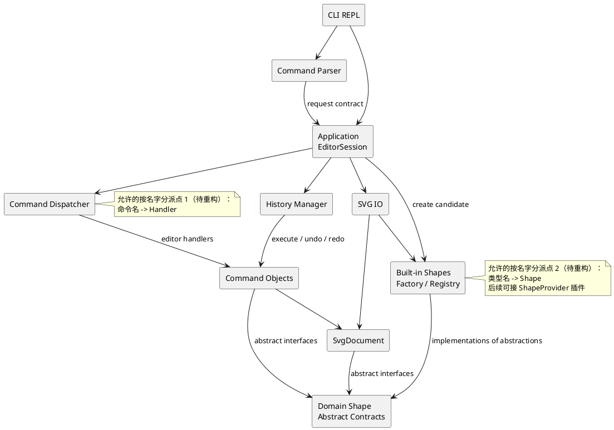

# SVG 编辑器（CLI）项目文档

本项目按照 `phase_cli_1.md` 实现一个基于 TypeScript、面向对象的 SVG 命令行编辑器。本文件是最终提交文档的工作版本，先确定架构基线；实现过程中如有必要，将在提交记录中迭代本方案。

架构基线：2026-10-26，v1.1；执行与质量要求、Parser、领域和应用入口实现更新：2026-10-27。逐阶段实施、状态与验收见根目录 [DEVELOPMENT_PLAN.md](../DEVELOPMENT_PLAN.md) v1.1。阶段 1–2、3A–3B 已完成；Factory/Registry、EditorSession Facade 和首个 CreateCommand 已落地。完整历史及 Composite 几何操作仍按后续阶段实现，不代表已经验收。

## 架构方案

### 1. 总体目标与边界

程序提供 `svg>` 交互式 REPL，编辑一个 SVG 文档，并支持：

- `init`、`read`、`save`、`canvas` 文档操作；
- rect、circle、ellipse、line、text、g 六种内置图形的创建与属性编辑；
- `move`、`scale`、`set`、`delete`、`group`、`ungroup`、`addto`、`front`、`back`；
- `tree`、`show`、`help` 查询；
- 编辑命令的 undo/redo，以及 IO 命令后的历史锁定规则；
- 外部 SVG 缺少 id 时自动补 id 并输出 warning；
- 保存后可被浏览器直接打开，并能重新读回。

本阶段不实现 `box`。架构只为后续 ShapeProvider 插件预留注册边界，内核遇到 `box` 时输出 `error: unknown shape type: box (is the plugin loaded?)`。

### 2. 模块划分

代码按职责拆分为以下模块。每个类放在独立文件中，文件名与类名一致；模块内部通过接口和多态协作。

| 模块 | 目录 | 主要职责 | 允许感知的内容 |
|---|---|---|---|
| 领域文档 | `src/domain/document/` | `SvgDocument`、画布尺寸、根级图形集合、id 索引、父子关系和文档级约束 | SVG 文档语义；不感知终端和文件系统 |
| 领域图形 | `src/domain/shapes/` | `Shape`、`ContainerShape` 等抽象契约；封装公共属性、几何操作和子树遍历接口 | 图形语义与 Composite 操作 |
| 图形注册 | `src/shapes/` | 六种内置图形类、`ShapeFactory`、图形类型注册表和 SVG 属性映射 | 类型名到图形类的唯一工厂分派 |
| 命令 | `src/commands/` | `Command` 接口及每个编辑命令；保存执行前状态并实现 `execute` / `undo` | 领域对象和命令结果，不读写终端 |
| 应用编排 | `src/application/` | `EditorSession`、命令注册与处理器、参数验证、`HistoryManager`、结果和 tree/show 格式化 | 命令、领域文档、工厂、IO 服务 |
| 输入解析 | `src/cli/parser/` | 通用词法解析：行拆分、双引号、整行注释；返回保留引号来源的词元 | 不按命令名或类型名二次分派，不改变领域状态 |
| CLI 界面 | `src/cli/` | REPL 生命周期、`svg>` 提示符、输入输出和错误前缀格式 | 应用层返回的结构化结果 |
| SVG IO | `src/io/` | XML 读取、序列化、缺失 id 自动分配、文件错误转换，以及外部解析禁用和输入资源限制 | 文档结构和图形工厂；不依赖 CLI |
| 测试 | `test/` | 领域、命令、IO、解析和 CLI 会话测试 | 被测公共接口 |
| 组合根 | `src/main.ts` | 实例化依赖、注册内置命令和图形、注入 IO、启动 REPL | 可依赖各模块用于装配 |

六种具体类型（含 `GroupShape`）只放在 `src/shapes/`，避免领域抽象与具体类重复归属。`SvgDocument` 持有领域抽象，负责统一维护树与索引；具体类不反向调用工厂。

阶段 3A 的结构实现：`SvgDocument` 是父子关系的唯一事实来源，Shape 不重复保存 parent/children；通过 `parentOf`、`childrenOf` 和 `walk` 查询，返回冻结的顺序快照。`insert`/`insertSubtree` 完整校验候选后才加入索引和树；`remove` 摘除整棵子树并返回冻结的 `ShapeSubtree` 拓扑，保留原 Shape 实例供恢复使用，不将其当作几何属性快照。命令恢复原位置时另行保存父节点和同级索引。跨文档的同一 Shape 实例在摘除前不得重复挂接；不同文档可以各自使用相同 id 的不同实例。几何变更与完整 Composite 行为按阶段 4B/4C 接入。

阶段 3C 的查询实现：具体图形覆写 `Shape.geometry`，基类 `attributes` 合并显式公共样式，返回冻结的属性快照；GroupShape 沿用空几何视图。`DocumentFormatter` 只依赖领域抽象，迭代读取文档关系并生成 tree/show；不按 type/tag 判断具体几何。两种查询使用规范属性名，show 从 `parentOf` 读取真实父节点，根级显示 parent=svg。文本与有特殊字符的值转义为单行，原属性不变。它是应用层格式化职责，不新增 Strategy 模式。

帮助同源：`CommandDispatcher` 的注册项同时保存处理器与语法回调；create 的回调枚举 `ShapeFactory` 同一类型表的 CLI 语法，内置语法直接由已有 schema 生成。回调在查询时求值，后注册的 CLI 类型也能显示，不执行参数解析或构造。扩展注册可同时提供 CLI parser 与语法；无 CLI parser 的内部类型不显示创建帮助。help 未初始化可用，只列当前已接入命令，后续阶段随命令注册补齐最终完整清单。

目标目录结构：

```text
src/
├── domain/
│   ├── document/
│   └── shapes/
├── shapes/
├── commands/
├── application/
├── cli/
│   └── parser/
├── io/
└── main.ts
test/
doc/
└── README.md
```

### 3. 运行时协作流程

一次编辑命令的调用链如下：

1. `Repl` 读取一行输入，由 `CommandParser` 跳过空行及整行注释；参数中的颜色 `#ffffff` 正常保留。
2. `CommandParser` 只产生词元请求并保留 quoted 信息，不负责按命令名或图形标签分派。
3. `EditorSession` 调用 `CommandDispatcher` 查找唯一命令注册项，由该项校验参数；create 通过 `ShapeFactory` 的类型注册项解析几何参数和尾部 `in`。
4. 应用处理器调用工厂构造未挂接的候选 Shape，再传给 `CreateCommand`；编辑命令只操作领域对象。read/save 等文档处理器在应用层调用 IO，不把 IO 注入编辑命令。
5. 编辑命令成功后进入 `HistoryManager` 的 undo 栈，并清空 redo 栈；失败时不修改文档也不入栈。
6. 应用层返回 `CommandResult`，由 CLI 统一输出成功摘要或 `error:` 信息。

`tree`、`show`、`help` 和无参数 `canvas` 不改变历史。成功的 `init`、`read`、`save` 和带参数 `canvas` 清空旧栈并设置 IO 锁定标记；undo/redo 报需求指定错误。下一次成功编辑建立新的历史并解除锁定；失败编辑和失败 IO 保留原文档、路径与历史。

`HistoryManager` 只在操作成功后移动栈项；撤销后只有新成功编辑会清空 redo。read 使用临时文档，save 先完整生成内容并写同目录临时文件，最终替换成功后才更新路径与历史。

当前实际流程为 `main.ts → Repl → CommandParser → EditorSession → CommandDispatcher → CommandResult → TerminalOutput`。`CommandRequest`、`CommandToken` 和 `CommandExecutor` 属于应用层边界契约；Parser 返回 skip/error/command，保留参数的值、顺序与 quoted 信息。REPL 对每行原文调用 Parser，词法错误只呈现，不调用执行器。EditorSession Facade 已接入 init/create，命令名由 CommandDispatcher 唯一分派；候选文档构造成功后才替换当前文档。ShapeFactory 同一注册项保存创建函数与 CLI 参数规则；按必填参数、可选样式、尾部未加引号 in 的顺序解析。CreateCommand 保存图形实例、父 id 和首次同级位置，execute/undo 通过领域插入/摘除完成，重复执行恢复原实例与顺序。当前未保留历史栈，CLI undo/redo 尚未开放。

### 4. PlantUML 组件图

下图展示模块依赖，运行时返回值不另画反向依赖；组合根 `src/main.ts` 负责创建具体实现并装配。



### 5. 设计模式及落地方式

#### Command：编辑行为的统一撤销边界

`Command` 接口至少提供 `execute(context)`、`undo(context)` 和结果摘要。`CreateCommand`、`DeleteCommand`、`MoveCommand`、`ScaleCommand`、`SetAttributeCommand`、`GroupCommand`、`UngroupCommand`、`AddToCommand`、`ReorderCommand` 分别封装一种编辑行为。

每条编辑命令对应一个 undo 单元。从首次接入 create 开始就走 Command 路径，不先实现一条绕过历史的直接编辑路径。命令保存父节点、同级位置、旧属性或封装快照；先验证完整候选结果再写入。move/scale 恢复旧几何值，不仅使用逆运算，以免浮点误差积累；redo 复用保存结果。`GroupCommand` 即使移动多个图形，也只作为一个命令进入历史栈。

文档操作采用相同的应用入口，由应用层文档处理器负责，编辑 Command 不持有 IO 服务。只有成功的文档操作清空历史并锁定，符合需求中“undo not allowed after io command”的规则。

#### Composite：统一容器与叶子操作

`Shape` 是所有图形的共同抽象，`ContainerShape` 提供容器契约，`GroupShape` 是具体实现。叶子封装几何属性与白名单，g 递归移动/缩放子孙；删除和重组由 `SvgDocument` 通过统一子树操作维护索引及归属。领域对象提供结构化属性视图，XML 生成位于 IO 层。命令不按标签区分容器和叶子。

`group`、`addto` 和 `ungroup` 改变树关系；move/scale 通过多态作用于子树。g 的 set 修改容器自身样式，保留 SVG 继承语义，不覆盖后代显式样式。普通 g 只有在嵌套时允许 ungroup，顶层 g 必须拒绝；未来插件的内部复合图形可通过容器能力契约拒绝解散。

#### Factory / Registry：隔离类型创建与扩展

`ShapeFactory` 将 `rect`、`circle`、`ellipse`、`line`、`text`、`g` 映射到具体类，并提供注册接口。读入 SVG 时由同一个工厂创建节点，避免 IO 层直接实例化具体图形。未注册类型统一生成未知类型错误。

注册项同时提供 CLI 参数与 SVG 元素构造入口，所有类型名查找集中在同一工厂。当前预留注册边界，后续可扩展为 `ShapeProvider` 的模板、set 传播和 data-kind 读回能力；本阶段不实现完整插件协议，也不新增 box 分支。

#### IO 隔离：按实际变化需求预留接口

`SvgReader`、`SvgWriter` 的边界隔离 XML 与文件系统，通过应用层使用。当前 id 分配和格式化只有单一规则，不额外拆 Strategy；等出现可替换算法时再评估，避免为了使用模式而增加类。

#### Facade：应用层的稳定入口

`EditorSession` 对 CLI 暴露稳定的执行入口，集中持有当前文档、工厂、IO 服务和历史管理器。CLI 不需要了解命令内部如何修改树；未来接入 GUI 或 HTTP 适配器时，可以复用同一应用入口。

### 6. 依赖方向规则

允许的依赖方向如下：

- `cli → application、cli/parser`：CLI 只处理交互和展示。
- `cli/parser → application`：解析器只构造结构化请求，不直接写文档。
- `application → commands、domain、io、shapes`：应用层负责组合依赖和生命周期。
- `commands → domain`：命令只通过领域接口完成编辑和恢复。
- `io → domain、shapes`：读写层把 XML 转为领域树或把领域树序列化为 XML。
- `shapes → domain`：具体图形实现领域抽象。
- `test → 任意生产模块`：测试只依赖被测公开接口。
- `main.ts → 上述模块`：组合根负责实例化和注册，是明确的装配依赖例外。

以下依赖禁止出现：

- `domain` 不得依赖 `cli`、`application`、`io` 或具体命令类；
- `commands` 不得直接调用终端 API 或文件系统；
- `shapes` 不得依赖命令分发器；
- `io` 不得依赖 CLI 的文本输出格式；
- 具体图形不得通过全局变量查找文档或其他图形。

理由是把 SVG 语义和树操作留在核心，把终端、命令语法和文件格式放在边界；这样每一层都能独立测试，也能在不改领域模型的情况下替换交互界面或 XML 实现。

按名字分派只保留两个位置：命令分发器的“命令名 → 处理器”和图形工厂的“类型名 → Shape 类”。两处均标注为**待重构点**：本阶段集中注册已足够，未来再评估动态注册发现机制。Parser、IO 和 tree/show 不得另设同类分派。

### 7. 变化点假设与预留取舍

1. **图形类型扩展**：最可能增加 box 等复合图形。预留 `ShapeFactory` 注册接口，后续再扩展为完整 ShapeProvider；本阶段不在核心命令中写 `box` 特判。
2. **命令语法扩展**：可能增加命令、别名、脚本或更严格的参数校验。预留 Parser 与 Command 分离；当前不为 GUI 手势设计另一套语法抽象。
3. **SVG 格式读写变化**：可能更换 XML 库、格式化策略或支持更多元素。隔离 `SvgReader`/`SvgWriter`；set 仅接受白名单，读入则保留六种支持节点上的附加普通属性和根 viewBox。transform 保留而不展开，未知图形标签明确拒绝；具体边界见开发方案，不承诺完整 SVG/CSS 引擎。
4. **撤销历史策略变化**：可能支持命令宏、历史持久化或更高效的快照。保留 Command 的执行/撤销边界和 `HistoryManager`；当前按单条命令保存恢复信息。
5. **交互渠道变化**：可能增加 GUI 或 HTTP API。由 `EditorSession` 返回结构化 `CommandResult`；当前不把展示字符串写入领域对象。
6. **文档规模变化**：未来可能处理更大的 SVG。当前先保证模型清晰和状态正确，不提前引入缓存、数据库或复杂增量索引；只有性能测试显示需要时再调整。

## 过程记录

本节只记录从已生成的文档或代码中发现的问题、确认方式和纠正动作。实现推进后按“问题 → 证据 → 修正”追加，不记录没有技术结论的流水账。

### 2026-10-26：初始化文档内容的校验

- **问题**：首次生成文档后通过 `Get-Content` 检查，发现 `doc/README.md` 实际为空，之前的写入命令没有把多行内容正确传入文件。
- **确认**：直接读取文件并检查 Git diff；提交中只有需求文档的新增内容，架构文档没有有效文本。
- **纠正**：改用补丁方式完整写入文档，并在提交前重新读取文件、检查 Git 状态和提交内容。

### 2026-10-26：审查生成的开发建议与架构基线

以下只记录本次从生成方案和既有文档发现的问题及修正，不将计划中的功能写成已经实现。证据来源为开发建议的阶段安排、本文原架构和需求 2.1、3、4.1—4.3。

| 发现的问题 | 确认依据 | 修正方式 |
|---|---|---|
| init 排在 IO 阶段，create 又先于 Command | 原建议第三阶段验收 CLI create，第六阶段才实现 init，第四阶段才引入 Command；当前文档前置条件和编辑路径不成立 | 阶段 3 提前接入 init，首个 create 就封装 Command；History 在阶段 4 扩展 |
| 领域和具体图形重复归属 | 原模块表同时在 domain/shapes 和 shapes 放叶子及 GroupShape | domain 只放图形抽象；六种具体类型及工厂放 shapes，同步修订模块表与图 |
| Parser 和工厂可能各建类型分发表 | 原 Parser 职责含所有命令参数和 in；需求 2.1 限定两处分派 | Parser 仅处理词元，命令注册项校验命令参数，工厂注册项校验类型参数；统一供 CLI 与 SVG 读入使用 |
| 编辑命令接收 IO 与只依赖 domain 冲突 | 原协作流程向命令注入工厂和 IO，但依赖规则只允许 commands → domain | 应用层先构造候选 Shape；CreateCommand 只接收领域对象；文档处理器在应用层调用 IO，明确组合根装配例外 |
| 单一实现仍拆 Strategy，且插件承诺超出阶段 | 原文列出 id/格式化多种策略并暗示完整 box 插件协议已可使用，实际本阶段未实现 | 保留 Reader/Writer 与注册边界，取消额外 Strategy；完整 ShapeProvider 留待后续 |
| 普通 g 的 ungroup 描述缺少顶层限制 | 原文称普通 g 允许解散，而需求 4.2 禁止顶层 g 解散 | 修订 Composite 描述，并把顶层拒绝、嵌套提升、原位恢复加入阶段 5 验收 |
| 仅校验异常不足以证明失败状态不变 | 需求要求失败不改任何状态，原建议没有覆盖历史、路径、多节点和中途溢出 | 补充完整候选验证、旧几何状态恢复、临时文档与文件替换；测试比较文档和后续历史行为 |
| 缺 id 补全可能撞上文件后部已有 id | 需求同时要求自动补 id 和全局唯一，原建议未给冲突算法 | 先收集显式 id，再跳过占用值生成；重复显式 id 拒绝，阶段 6 加入 fixture |
| #、in、g set 与外部属性的边界不清 | 参数有 # 颜色与引号文本，set 白名单不等于读入可丢弃额外属性；原建议未规定处理方式 | 执行方案区分明确需求与默认决策，补充词法、继承、scale、transform 和未知元素测试边界 |
| 阶段较大，验收未覆盖完整架构约束 | 基础编辑阶段含多个命令和历史，容易大提交；最终检查缺少实际 import 和模式证据 | 拆分 3A—6C 等提交点，模块完成即反馈并 push；最终自查必须引用实际文件和验证结果 |

此次形成根目录 `DEVELOPMENT_PLAN.md` v1.0，并将架构修订为 v1.1。尚未实现生产代码，默认语义及测试计划将在对应阶段落地验证。

### 2026-10-27：复核执行体系审核并补齐交付门槛

本次根据审核意见重新检查自己生成的 `DEVELOPMENT_PLAN.md` v1.0、根 README 和本文，确认以下缺口真实存在，采纳四项主要建议。它们补充执行与交付要求，不改变模块和设计模式；尚未将 CI 或输入限制实现为代码。

| 发现的问题 | 确认依据 | 纠正方式 |
|---|---|---|
| 阶段复选框只有完成/未完成，且开头状态描述会过时 | v1.0 第 8 节只有 15 个勾选项，没有进行中、验收证据、实现 SHA、CI 或阻塞记录 | 改为五态进度表和阶段记录模板；完成需验收、推送和该实现提交的 CI 证据。反馈持续说明已完成、证据、阻塞和下一步 |
| 记录 SHA 容易形成自引用，审核意见未说明如何维护 | 如果把记录文件所在提交的 SHA 写入文件，修改文件又会产生新 SHA | 实现提交验收后用独立小文档提交记录其 SHA；记录提交自身的 push/CI 在阶段报告核实，最终 tag 仍需指向通过检查的最终提交 |
| 使用者交付缺少根 README | 根 README 只有项目标题，v1.0 阶段 7 关注课程验收但没有使用说明清单 | 阶段 1 先交代环境与可用入口，阶段 7 完成交接：安装、启动、示例、预览、SVG 范围、限制和文档链接；保持课程/个人工具定位，不增加 npm 发布流程 |
| 本地检查无法保证后续提交重复通过 | v1.0 有 typecheck/build/test，但无 Node/npm 基线、CI 和格式门槛 | 采用 Node.js 24 LTS，在阶段 1 确定 npm 主版本；加入 Windows/Linux push/PR CI、npm ci 和 Prettier 检查，不设置任意覆盖率目标 |
| CI 成功不能自动等同全部验收 | 提示符、实际浏览器显示和架构抽样不完全被自动化任务覆盖 | 精确记录 CI 对应 SHA 与链接，并保留交互/浏览器手工证据；不默认修改分支保护配置 |
| SVG 读入缺少外部实体与解析期间资源限制 | v1.0 规定临时文档和失败恢复，但未禁 DTD/外部资源，也未限制输入大小、深度和节点数 | 阶段 6 选库时验证并禁用外部解析；初始预算 5 MiB、128 层、50,000 元素，解析期间检查，边界与超限测试通过后落实到实现和 README |
| 资源限制值与安全承诺需要限定 | 审核建议值按库能力确定；仅限制 XML 不会消除保留属性中的浏览器行为 | 将限值标为待阶段 6A 验证的初始预算，调值须有证据；不把读写器宣传为 SVG 净化工具，也不声称已安全处理任意外部 SVG |

修订结果：根开发方案 v1.1，新增持续状态与证据记录、使用者交付清单、仓库级门槛及 XML 输入边界。所有实现阶段仍为未开始，当前无生产代码测试或 CI 通过证据。

### 2026-10-27：工程和 REPL 实现中的问题校验

| 发现的问题 | 确认依据 | 纠正方式 |
|---|---|---|
| 初选测试框架版本带入已知漏洞，镜像源不能提供有效审计 | 安装 Vitest 3 后在 npm 官方源执行 audit，报告 3 项漏洞（1 moderate、2 critical）；本地镜像源的 audit 接口返回 404，不能作为无漏洞证据 | 更新至 Vitest 4.1.12，使用官方源生成锁文件并重新安装、审计，结果为 0 漏洞；不将镜像源审计不可用写成通过 |
| 工程骨架允许没有测试仍成功，且类型检查只覆盖源码 | 检查生成的脚本发现 `--passWithNoTests`；tsconfig 只包含 src，测试中的类型错误可能不被 tsc 检出 | 加入真实输入循环和入口测试后移除空测试放行选项；增加 tsconfig.test.json，typecheck 同时检查 src 与 test |
| 首次 CI 在 Windows 格式检查失败，Linux 成功 | `a65140f` 的 CI 40461811313 中 Windows 的 format:check 失败、后续检查跳过，Linux 成功；尚未获取原始失败日志，按平台换行差异假设修正并重跑 | 独立提交 `9ca1c8a`，通过 .gitattributes 固定文本 LF、Prettier 显式 endOfLine=lf；CI 40462330364 在 Windows/Linux 均通过，确认该修正消除了跨平台格式失败，不据此断言已读取失败日志 |
| REPL 的关闭状态和提示符实现没有覆盖提前 EOF | 首次访问非公开的 reader.closed 导致 TS2551；改用无条件 prompt 后，预缓冲输入的 4 项测试报 `readline was closed`，证明 EOF 到达时仍可能有待处理行 | 用公开 close 事件记录关闭；真实终端仅在未关闭时调用 prompt，管道独立写提示符并继续消费队列。加入空 EOF、末行无换行、异步顺序测试；10 项测试及 Windows 真实终端 Ctrl+D 验收通过 |
| 文档仍称“没有生产代码”和“REPL 未实现” | 对照新增 src/cli、应用结果契约和 2 个测试文件，根 README 与一致性自查已经过时 | 同步当前可用行为、暂不支持的业务命令、实际依赖和验收证据；保留以日期标记的旧审查结论作为历史，不把计划模式写成已落地 |

### 2026-10-27：复核阶段一测试覆盖建议

两项建议均采纳，属于回归证据补强，不是已确认的运行缺陷。检查自己生成的 `Main.test.ts`，仅有 tsx 源码子进程测试；REPL 测试将异步执行顺序和输入流失败分开验证，没有交叉场景，手工补查无法持续防止回归。

- **编译入口**：将入口测试参数化，同时启动源码与 `dist/main.js`，断言欢迎语、过滤、错误及 EOF 退出。增加 npm 的 pretest 构建钩子，确保本地 `npm test` 和 CI 都先重新构建，不依赖遗留 dist；CI 的独立构建步骤并入该钩子，避免重复构建。
- **异步中输入失败**：用受控 Promise 确保执行器尚未完成，再销毁输入流，确认错误事件已发生后才释放执行器；断言 REPL 最终拒绝原输入错误且没有多次执行。验证通过，无需修改 REPL 生产逻辑；不以计时 sleep 制造竞态。
- **结果**：2 个测试文件、12 项测试通过（原 10 项全部保留，新增编译入口和交叉场景各 1 项）。推送与 CI 证据在开发方案中追加。

### 2026-10-27：Parser 边界与生成测试的校验

- **问题**：生成方案要求保留 quoted 标记，却未规定部分引号拼接时的含义；同时阶段 2 写“测试注册项契约”，阶段 3B 才引入分派注册项，容易提前增加占位框架。
- **确认**：对照开发方案阶段 2/3B 和 `in` 必须为尾部未加引号子句的约束；`"in"suffix` 若接受拼接，将无法仅用布尔标记表达整词来源。
- **修正**：双引号只包裹完整词元，拼接报受控词法错误；Parser 对未知命令、类型、非法数值和参数数量不做语义判断。阶段 2 建立只读请求与执行器契约，注册项与语义测试明确随阶段 3B 实现。
- **生成测试问题**：末尾反斜杠 fixture 最初使用 raw 模板字符串，反斜杠转义了模板结束符，Prettier/Vitest 均报告未闭合字符串，尚不能验证 Parser。改为显式转义的普通字符串后，24 项词法测试和原 12 项回归全部通过；不将测试文件的语法错误误认为解析器缺陷。

### 2026-10-27：复核图形工厂的扩展边界

- **问题**：生成的扩展 specification 使用任意字符串类型，可能以 `g` 等内置名字携带扩展 properties；原工厂直接断言类型，且未验证扩展回调返回的节点身份。扩展回调若返回其他 id/type，会破坏后续文档索引和序列化的一致性。
- **确认**：检查 `ShapeCreationSpecification` 的联合类型与注册表调用边界，新增内置名字扩展 payload、覆盖内置注册、返回错误 id/type 的测试。
- **纠正**：保留唯一类型注册表；内置与扩展构造数据入口互斥，重复注册拒绝且不替换原项，构造结果核对 id/type。接口命名为 `register`，仅承诺未来类型扩展点，不将其描述为已实现插件加载协议。六种内置构造器校验有限几何值及非负尺寸/描边宽度。
- **阶段边界复核**：只读 getter 是字段封装，并不要求采用不可变对象替换策略；几何运算与受控状态恢复仍随阶段 4B/4C 引入。当前不提前实现编辑命令，也不把图形构造验收冒称为 Composite 移动/缩放验收。

### 2026-10-27：真实入口接线后的文档一致性校验

- **发现**：接入 EditorSession/init 后，根 README 和架构运行流程仍宣称真实入口只返回阶段占位错误，与新代码及入口测试不符。
- **确认**：对照 main.ts 的实例化、EditorSession 的 init 注册以及源码/编译入口子进程输出，确认已能创建画布；create、历史与 IO 此时尚未接入。
- **修正**：同步欢迎语和当前接线与功能边界，保留未实现能力的说明。验收用真实入口断言成功摘要，避免只有注入的假执行器测试通过。

### 2026-10-27：create 参数边界与可扩展接线校验

- **发现**：最初生成的工厂 CLI 适配器只返回 specification，把 parentId 固定为 null；若继续在 EditorSession 扫描 in，则既会丢失嵌套语义，也会把类型参数知识移出注册项。另一个数值隐患是 Number(空字符串/纯空白) 得到 0，可绕过“非数值拒绝”的意图。
- **确认**：对照需求 create 类型参数和尾部 in 规则，以文本 "in"、id in、带样式嵌套及空字符串坐标构造回归输入；检查注册项与应用处理器之间的返回数据，确认原适配器没有父容器信息。
- **纠正**：注册项返回 specification 与 parentId；schema 先消费必填参数，再处理可选样式及尾部未加引号 in。数值转换前拒绝空/纯空白，再验证有限值，非负尺寸由图形构造器约束。增加状态快照比较，确认错误参数、重复 id 和错误父目标不改变树、索引及顺序。
- **依赖修正**：工厂使用 shapes 内的只读 ShapeCliToken 结构边界，与应用词元结构兼容，不反向 import application/CLI。为注册入口增加可选 CLI 解析回调，测试新增 marker 类型可通过同一 create 路径；这只是扩展验证，不实现 box 或插件加载器。

### 2026-10-27：查询属性边界与显示安全校验

- **发现**：已有图形类只提供各自 getter，缺少统一属性入口；直接让 tree/show 读取具体类会使显示层知道全部图形类型。已有模型还允许文本、id 和样式含换行等字符，直接插值会破坏树的行结构。
- **确认**：逐项检查 Shape 和六种具体类的公开接口；用包含中文、引号、反斜杠、换行、控制字符的 TextShape 作为查询输入，并以自定义 marker 类型检验扩展是否要求修改格式化器。
- **纠正**：提供只读 geometry/attributes 视图，将样式合并留在 Shape，排版和字符转义留在 DocumentFormatter。tree 迭代遍历而不递归调用，测试 1500 层领域树；六种图形、缺省/显式样式、真实父关系、子树和失败状态均有回归。查询没有引入新的名字分派或编辑命令，完整历史仍留待 4A。

### 2026-10-27：帮助清单与执行能力的一致性复核

- **发现**：原分派器只保存处理器，工厂已有参数 schema 却不暴露帮助。单独硬编码 help 清单会复制类型列表；若一次列出后续全部命令，又会把尚未实现的 undo/read 等显示为可用。
- **确认**：对照 CommandDispatcher 注册表、ShapeFactory 的六种 schema 及当前 EditorSession 接线，确认本阶段实际只具备 init/create/tree/show/help；最终需求的“全部命令”须随后续阶段补齐。
- **纠正**：语法与处理器/图形 parser 保存在原有注册项，内置 create 语法由 schema 生成；help 动态枚举当前可执行注册信息并注明阶段范围。用后注册 marker、无 CLI parser 类型、未初始化 help、错误参数和两种入口会话验证同源行为及状态不变，不新增名字分派。
- **自查修正**：初版扩展帮助缺省为 `<id> [parameters]`，但注册回调可能要求必填参数，无法从任意 parser 推断。改为明确提示附加语法未提供；注册者可传入准确语法，测试覆盖两种情况，不把未知参数错误标为可选。

## 一致性自查

阶段 2 实际源码抽样（2026-10-27）：

1. **模块划分与封装**：`src/cli/Repl.ts`、`TerminalOutput.ts`、`src/cli/parser/CommandParser.ts` 各自单类同名文件；REPL/输出使用私有字段，Parser 无跨行可变状态。application 的请求/词元为只读传输契约，执行器为接口，不承担领域模型职责。`src/main.ts` 显式装配 Parser 和执行器。已删除临时 `src/cli/LineExecutor.ts`；领域、命令、图形与 IO 按后续阶段建立，没有空类占位。
2. **依赖方向**：逐项检查实际 import：CLI 依赖应用契约与内部 Parser；Parser 仅依赖 application 的请求/词元类型；application 契约只互相引用，不依赖 CLI 或 Node IO；组合根依赖 CLI 与应用契约；测试依赖公开接口与 Node 流/进程。未发现反向依赖。Parser 没有按命令名或图形名分派，计划中的两处注册表仍未实现。
3. **模式实际状态**：使用依赖注入隔离终端、Parser 和结构化执行器，尚未实现业务 Command、Composite、Factory/Registry 和 Facade。只读请求契约不等于业务 Command 对象；后续首个 CreateCommand、图形树及 EditorSession 落地时补充实际证据，不提前计入模式使用。

阶段 3A 增量源码抽样（2026-10-27，补充上面的历史检查）：

1. **模块与封装**：抽查 `src/domain/document/SvgDocument.ts`、`src/domain/shapes/Shape.ts`、`ContainerShape.ts` 及 `src/shapes/RectShape.ts`、`TextShape.ts`、`GroupShape.ts`、`ShapeFactory.ts`。生产类均一类一文件、字段私有；图形公开只读 getter。文档独占索引和关系存储，不公开可修改集合；内部 `DocumentNode` 和只读 `ShapeSubtree` 是关系记录，不代替领域对象行为。
2. **依赖方向**：`SvgDocument` 仅依赖领域图形抽象与拓扑类型；六种具体类型只依赖领域抽象；工厂依赖具体类型与创建 specification；领域层没有 CLI、application、具体图形、Node 或文件系统 import。现有 REPL/Parser 接线保持阶段 2 行为。
3. **模式实际状态**：Factory/Registry 已由 `ShapeFactory` 的单一注册表落地，注册保护和返回身份验证有测试。`GroupShape extends ContainerShape extends Shape` 与文档子树形成结构基础，但完整 Composite 移动/缩放及 set 仍在后续阶段验收；Command 和 Facade 尚未实现，不将领域插入/摘除冒称为 CLI 命令或完整历史管理。
4. **原子性与恢复**：抽查 `insertSubtree`，先验证全部候选 id、归属、父容器与位置，再修改关系和索引。`remove` 先构造冻结拓扑，再统一摘除子孙。测试比较失败前后可观察的树、索引、归属及顺序，并确认失败候选未被占用、恢复保留原实例。

阶段 3B 增量源码抽样（2026-10-27）：

1. 抽查 `src/application/EditorSession.ts`、`CommandDispatcher.ts`、`src/commands/CreateCommand.ts`、`src/shapes/ShapeFactory.ts` 和 `src/main.ts`。生产类保持单类同名文件、字段私有；Command 接口不依赖应用层结果。
2. EditorSession 组合命令、领域与工厂；CreateCommand 只 import 领域及 Command；工厂只依赖领域抽象、具体类型与 shapes 内数据契约。Parser 和领域没有业务接线变更，类型/命令名仅在两个注册表查找，无额外 switch。
3. Command 由 CreateCommand 首次落实，保存实例、父 id 与同级索引，失败插入不推进命令状态；测试执行→撤销→重执行并恢复身份及顺序。Facade 已提供真实结构化入口，Factory/Registry 同时支持结构化数据与 CLI 创建。History 和完整 Composite 仍按后续阶段实现。

## 质量保证手段

阶段 3B 当前本地证据：10 文件 156 项通过，包含原 91 项回归、Dispatcher/init 17 项、create 应用集成 39 项、CreateCommand 4 项、工厂 CLI 扩展保护 3 项及源码/编译入口新增 2 项。严格类型检查、构建、Prettier 和 diff 检查通过。六种图形根级/嵌套、空/中文文本、in 词元歧义、非法数值、父目标错误、未初始化、unknown box、失败状态不变及 init 重置已覆盖；真实入口连续错误后可继续成功创建。远程精确证据及最终状态见开发方案第 8 节。

阶段 3B 远程与手工验收：3B.1 `3659408` 随文档 `f16c816` 推送，由该最终提交的 [CI 40472518602](https://github.com/Mengyzh-2003/SVG-cli/actions/runs/40472518602) 验证；3B.2 `7854c52` 独立推送并通过 [CI 40473725887](https://github.com/Mengyzh-2003/SVG-cli/actions/runs/40473725887)，均在 Windows/Linux 成功。在 Windows PTY 创建画布、组与中文文本，错误父目标之后下一条创建仍成功，Ctrl+D 退出码 0。完整 SHA 与范围见开发方案第 8 节。

当前本地证据（阶段 3A）：Node.js 24.15.0 / npm 11.12.1，严格源码/测试类型检查、构建、Prettier 检查和 diff 空白检查通过；6 个测试文件共 91 项通过。新增领域契约 4 项、六种图形与工厂 15 项、文档树 28 项；原 Parser 24 项、REPL 16 项、源码/编译入口各 2 项全部保留。文档树覆盖默认/非法画布、大小写敏感 id、父子关系与顺序、冻结快照、重复/非法插入前后状态相等、跨文档归属、环拒绝、子树摘除恢复及千层树的迭代处理。此时 CLI 仍未调用领域对象，领域原子性与词法错误不执行是分别验证的边界，不冒称业务端到端验收已通过。

阶段 3A 三个实现提交均已分别推送并通过 Windows/Linux CI：[图形契约 34de27b](https://github.com/Mengyzh-2003/SVG-cli/actions/runs/40468255670)、[图形与工厂 1db5e7f](https://github.com/Mengyzh-2003/SVG-cli/actions/runs/40470080167)、[文档树 45aa8c8](https://github.com/Mengyzh-2003/SVG-cli/actions/runs/40470589609)。完整 SHA、远程核实与验收边界见开发方案第 8 节。

手工证据：在 Windows PTY 运行 `node dist/main.js`，验证空行、含未闭合引号的整行注释被跳过，未闭合文本输出一行词法错误，下一条中文/含 #/in 的合法词法输入到达阶段占位执行器，空提示符 Ctrl+D 退出码为 0。源码与编译入口都由真实子进程测试持续验证。阶段 1 补强提交 [CI 40465418386](https://github.com/Mengyzh-2003/SVG-cli/actions/runs/40465418386)、阶段 2A [CI 40465817080](https://github.com/Mengyzh-2003/SVG-cli/actions/runs/40465817080) 及阶段 2B [CI 40466534090](https://github.com/Mengyzh-2003/SVG-cli/actions/runs/40466534090) 均在 Windows/Linux 通过；精确实现 SHA、远程核实及完成状态见根开发方案第 8 节。

后续阶段仍须落实以下证据，不把下述计划写成已通过：

- 接入命令注册项语义与领域模型，扩展 Composite 移动/缩放和命令失败状态不变性测试；保留已有 id/工厂/父子关系及 Parser、REPL 回归。
- 对每个编辑命令验证“执行 → undo → redo”，覆盖 redo 清空、IO 后禁止 undo 和错误命令不入栈。
- 用含缺失 id、嵌套 g、文本和非法文件的 SVG 做读入测试，验证自动补 id 警告和错误前缀。
- 对保存结果做 XML 检查，再 read 回来比较画布、层级、属性和文本，验证 round-trip。
- 运行 TypeScript 类型检查、测试命令和典型 CLI 会话；每完成一个小模块先验证，再单独提交并推送。
- 阶段 1 起按 Node.js 24 LTS / 约定 npm 主版本建立 Windows、Linux CI；每次 push/PR 运行 npm ci、format:check、typecheck、build 和 test，保留精确 SHA 的结果链接。CI 不能替代交互与浏览器验收。
- 阶段 6 验证外部实体/网络解析禁用、DTD 拒绝，以及大小、深度、元素数量的解析期间限制；超限失败不改变文档、路径或历史。
- 根开发方案第 8 节持续记录阶段状态与证据；最终按根 README 从干净检出验证使用者交接。
