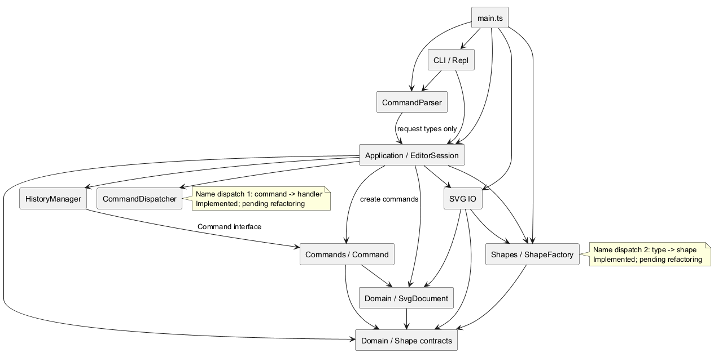
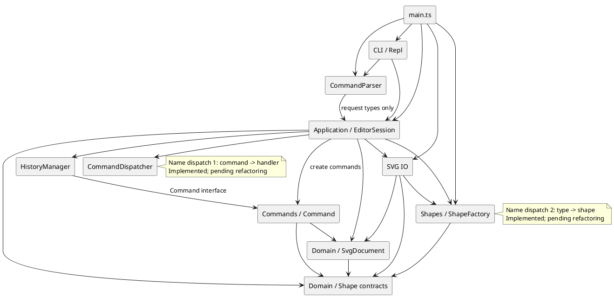
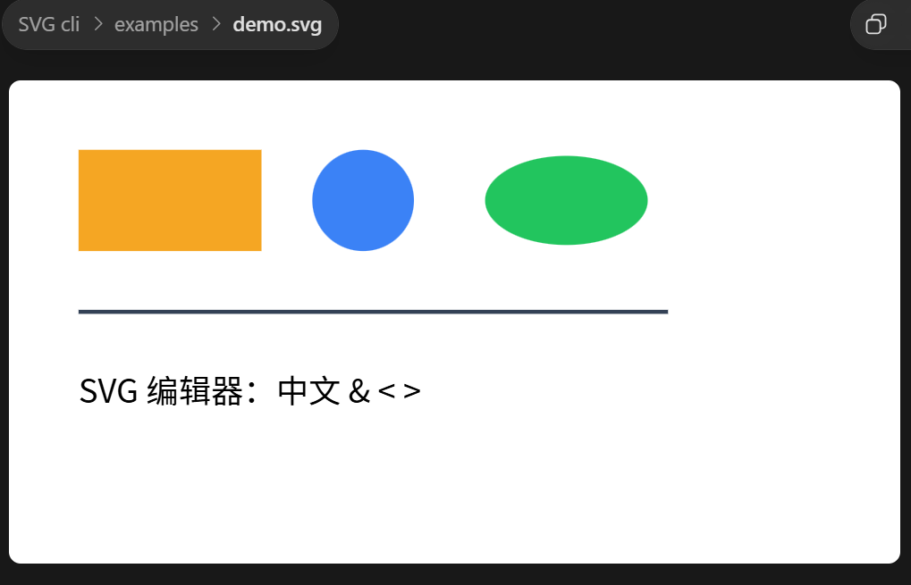

# SVG 编辑器（CLI）项目文档

需求依据：[phase_cli_1.md](../phase_cli_1.md)。实施、提交与 CI 证据：[开发执行方案](../DEVELOPMENT_PLAN.md)。本文按需求 1.2 的四节组织；当前版本仍供审查，`final` 标签按我的要求等待最终版本确认。

## 架构方案

### 1. 模块划分与职责

目标：用 TypeScript 和面向对象方式实现 SVG 文档编辑 REPL，覆盖六种内置图形、19 条命令、组合操作、撤销重做和 SVG 读写。本阶段不实现 `box` 或完整 ShapeProvider 插件协议，只保留图形注册扩展点。

| 模块 / 目录 | 主要类或契约 | 职责 |
|---|---|---|
| `src/domain/document/` | SvgDocument、ShapeSubtree | 画布、唯一 id 索引、父子关系、同级顺序、子树操作及拓扑约束 |
| `src/domain/shapes/` | Shape、GeometryShape、ContainerShape、GeometryChange、AttributeChange、TreeChange | 图形抽象、属性封装、多态几何操作和受控变更/恢复 |
| `src/shapes/` | 六种具体 Shape、ShapeFactory | rect/circle/ellipse/line/text/g；同一类型注册项提供构造、CLI 参数规则和 SVG 转换 |
| `src/commands/` | Command、各编辑命令、GeometryCommand | 一条编辑对应一个命令对象，保存执行/撤销状态，复用几何命令生命周期 |
| `src/application/` | EditorSession、CommandDispatcher、HistoryManager、DocumentFormatter、请求/结果契约 | 参数校验、命令编排、会话与历史、结果摘要、查询和帮助 |
| `src/cli/parser/` | CommandParser | 单行词法、双引号、空行和整行注释，保留词元 quoted 来源 |
| `src/cli/` | Repl、TerminalOutput | `svg>` 输入循环、异步顺序、统一输出、错误/警告和 EOF |
| `src/io/` | SvgReader、SvgWriter、SvgFileStore、错误类 | XML 转换、自动 id、有界文件读写、错误转换及临时文件替换/清理 |
| `src/main.ts` | 组合根 | 创建并注入工厂、文件适配器、会话、Parser、REPL，启动程序 |
| `test/` | 领域、工厂、命令、应用、Parser、IO、CLI 测试 | 验证行为和失败状态，通过源码/编译入口回放真实会话 |
| `examples/`、`doc/evidence/` | 命令样例、SVG、截图 | 可复现使用示例与视觉证据，不参与生产依赖 |

具体图形只放在 `src/shapes/`，领域层只认识抽象。`SvgDocument` 是拓扑的唯一事实来源，Shape 不重复保存 parent/children；公开 getter 与冻结视图只读，变更通过领域行为完成，不开放可修改集合。

### 2. PlantUML 组件图

下图表达源码依赖，结果返回不另画反向箭头。`main.ts` 负责装配，`EditorSession` 创建编辑命令；Dispatcher 只调用处理器，不直接依赖具体命令类。



可编辑源文件：[architecture.puml](architecture.puml)。PlantUML 源码如下：



图中两处名字分派按需求 2.1 标记为**待重构**，表示架构演进点，不表示当前未实现。Parser、IO、查询和领域层不另建命令名/图形类型名分派。

### 3. 一次命令的协作流程

1. Repl 将原始单行交给 CommandParser。空行/整行 `#` 注释跳过；词法错误直接输出，不调用执行器。
2. Parser 返回带 quoted 信息的 CommandRequest。EditorSession 经 CommandDispatcher 找到处理器；命令参数由处理器校验，create 类型参数及尾部未加引号 `in` 由工厂注册项校验。
3. 编辑处理器构造 Command，并由应用层生成反馈；HistoryManager 执行成功后才入 undo 栈、清空 redo。失败不迁栈，CLI 只呈现结构化 CommandResult。
4. 查询不进入历史；成功 init/read/save/canvas 修改清空并锁定历史，下一条成功编辑开始新历史；查询和失败请求保持历史。
5. read 构建完整候选文档后才发布文档、路径和 warning；save 完成序列化及文件替换后才更新路径和历史。IO 未完成时拒绝重叠应用请求，完成/失败后释放执行门。

### 4. 设计模式的选择与代码落地

| 模式 | 实际位置与用途 | 选择理由 |
|---|---|---|
| **Command（必需）** | [Command](../src/commands/Command.ts)、各编辑命令、[HistoryManager](../src/application/HistoryManager.ts) | 编辑封装为 undo 单元；多节点 group 一次整体恢复 |
| **Composite** | [Shape](../src/domain/shapes/Shape.ts)、[ContainerShape](../src/domain/shapes/ContainerShape.ts)、[GroupShape](../src/shapes/GroupShape.ts) 与 [SvgDocument](../src/domain/document/SvgDocument.ts) | 容器和叶子共享图形契约，文档通过统一子树接口移动、缩放、删除 |
| **Factory / Registry** | [ShapeFactory](../src/shapes/ShapeFactory.ts) | 唯一类型注册表集中创建、CLI/SVG 转换，新增类型不在各命令增加判断 |
| **Facade** | [EditorSession](../src/application/EditorSession.ts) | CLI 经稳定入口使用编辑、查询、历史和 IO，不了解内部协作 |
| **Template Method（局部）** | [GeometryCommand](../src/commands/GeometryCommand.ts)、MoveCommand、ScaleCommand | 固定准备、应用、恢复生命周期，子类只覆写准备钩子 |

Command 的实际契约是 `execute(): void`、`undo(): void`，依赖在构造时注入；redo 对同一对象再次 execute。Create/Delete/Move/Scale/SetAttribute/Group/AddTo/Ungroup/ReorderCommand 实现该契约。摘要由应用层生成，HistoryManager 冻结保存撤销/重做反馈，命令不依赖终端结果类型。

领域变更先验证完整候选，再提交。move/scale 保存几何前后值，undo 不依赖逆运算；set 恢复属性缺失时用 undefined，不擅自写入默认样式。g 的 set 只改本地样式，保留继承；几何操作对子孙各处理一次，文字只缩放位置，不缩放字体和描边宽度。

group/addto/ungroup/front/back 使用 TreeChange 保存受影响拓扑；应用/恢复前检查实例、归属、预期关系和最终父链无环，再统一写入。同父 group 占最早选中位置，跨父 group 放根末尾，孩子按原文档顺序；addto 放目标末尾，front/back 只调整同级。普通 g 仅嵌套时可 ungroup，孩子原位提升；重组保持本地属性，不补偿继承样式或 transform 造成的外观变化。

IO 隔离采用类边界及文件读写结构接口：Reader/Writer 不访问文件或历史，FileStore 不持有文档。当前 id 分配和排版各一种规则，不额外拆 Strategy；不为模式数量引入抽象。

### 5. 依赖方向规则与理由

| 发起方 | 允许依赖 | 理由 |
|---|---|---|
| cli | application、cli/parser、Node 输入输出流 | 终端交互隔离，复用应用入口 |
| cli/parser | application 的请求/词元类型 | 词法不执行编辑、不依赖会话实现 |
| application | commands、domain、shapes、io 及本模块 | 编排领域/外部服务，管理生命周期 |
| commands | domain 及本模块 | 编辑与恢复不需要终端或文件系统 |
| shapes | domain 及本模块 | 具体类型实现抽象，领域不感知工厂 |
| io | domain、shapes、Node 文件接口、XML 库及本模块 | 转换文件/XML与领域对象，不依赖 CLI 呈现 |
| domain | 仅 domain | 核心语义独立于应用、具体图形、终端和文件 |
| main.ts | 上述生产模块 | 显式组合根装配例外 |
| test | 被测公开接口、测试工具 | 测试不进入生产依赖图 |

禁止领域反向依赖 application/cli/io/shapes，禁止 commands 调用终端或文件，禁止 IO 依赖 CLI 文本，禁止具体图形通过全局变量查找会话或其他图形。违反规则的依赖须记录为待处理项；架构层的模块化宽容不能豁免面向对象范式要求。

### 6. 变化点假设与预留取舍

| 可能变化 | 当前预留 | 暂不实现及原因 |
|---|---|---|
| 新图形与 box | 工厂注册、多态、容器可解散能力契约 | 插件加载、子部件 id、传播与 data-kind 还原属于后续阶段 |
| 新命令/别名/参数 | Dispatcher 注册项含处理器和必填语法回调；create 帮助复用 schema | 不在 Parser 新增分派，不另建帮助表 |
| SVG 格式范围/XML 库 | Reader/Writer 与文件适配隔离；工厂 SVG 转换和 svgAttributes/textContent | 不提前实现完整 SVG/CSS/引用引擎，未知元素明确拒绝 |
| 更多交互渠道 | CommandRequest、CommandResult、EditorSession | 本阶段不实现 GUI/HTTP，不将终端排版写入领域 |
| 历史与大文档 | Command 恢复状态、独立历史、迭代遍历、输入预算 | 暂不加持久化、缓存、数据库，先以测量证明需求 |
| id/显示策略 | Reader 的 id 规则、DocumentFormatter 的排版 | 当前各一种规则，不额外增加 Strategy |

## 过程记录

以下以我的项目复核视角记录代表性迭代。线索包括我审阅的 AI 产物与审查反馈；“我确认”表示我依据代码、复现或验收证据作出判断，不将 AI 执行的操作改写为我亲自执行，也不将收到的反馈冒称为我独立首次发现。精确提交和 CI 证据集中在开发方案第 8 节。

### 1. 开发顺序与模块归属的修订

- **我发现的问题**：AI 方案先 create、后 init 和 Command；领域抽象与具体类型重复归属，Parser 可能建立第三个分发表。
- **我如何确认**：我对照文档前置条件、强制 Command 和两处分派限制，确认原顺序无法形成可验收闭环。
- **我如何纠正**：我要求 init 提前、首个 create 即走 Command；抽象归 domain，具体类型归 shapes，Parser 只做词法；修订计划与架构。

### 2. 执行与交付门槛的补齐

- **我发现的问题**：AI 的复选框计划缺少状态/证据，根 README 缺使用说明，Node、CI、XML 边界未明确。
- **我如何确认**：我逐项核对原计划，确认均为实际缺口，补齐不需要改动核心架构。
- **我如何纠正**：我采用状态、测试/提交/CI 记录，固定 Node 24/npm 11.12.1，要求 Windows/Linux 检查、运行指南和输入预算；不设置无依据的覆盖率比例。

### 3. REPL 与真实入口的回归边界

- **我发现的问题**：早期 REPL 对提前 EOF 处理不足；AI 的测试只启动源码，异步顺序与输入失败也仅分别验证。
- **我如何确认**：我依据预缓冲输入的 `readline was closed` 失败，确认 EOF 后仍有待处理行；检查 Main 测试确实只用 tsx。
- **我如何纠正**：我要求通过公开 close 事件管理状态，区分终端/管道提示符；入口参数化为源码/编译两组，由 pretest 构建；补执行器挂起时输入失败的受控 Promise 场景，不用 sleep 制造竞态。

### 4. Command 契约与帮助登记约束的统一

- **我发现的问题**：AI 文档仍写 execute(context)/undo(context)，与构造注入、无参接口不符；帮助语法可省略。
- **我如何确认**：我对照 Command、CreateCommand、EditorSession、Dispatcher，确认摘要实际由应用层生成；现有命令登记正确，但约束过宽。
- **我如何纠正**：我统一文档为无参契约，明确历史保存应用反馈；语法回调必填并运行时校验，帮助与执行能力同源。

### 5. 几何变更的原子性与精确恢复

- **我发现的问题**：逐个修改子孙可能在末端溢出时留下部分变更，反向运算撤销可能有浮点误差。
- **我如何确认**：我核对前部正常/末端极大坐标的失败用例，以及 0.1 加 0.2 的恢复证据，确认需要比较整棵子树状态。
- **我如何纠正**：我要求完整准备 GeometryChange 后统一应用，保存原值/结果供 undo/redo；用深树、溢出、样式和文本保持验证，沿用 Composite 与局部 Template Method。

### 6. 拓扑恢复的间接成环风险

- **我发现的问题**：AI 实现若只检查直接受影响记录，会遗漏外部调用改变间接祖先后形成的环。
- **我如何确认**：我依据跨父 group/addto 后再改祖先的回归，核实移除最终父链检查时两项测试失败，恢复后通过。
- **我如何纠正**：我要求候选关系覆盖现有关系后迭代检查最终父链，再写入；失败不推进命令状态，冲突消除后可重试。我不把领域接口边界误写为正常 CLI 中已发生的故障。

### 7. SVG 语义与命名空间的保留

- **我发现的问题**：用编辑属性直接输出 XML 会把 text 子文本当属性；重组后来自祖先的命名空间绑定也可能丢失。
- **我如何确认**：我对照 TextShape.geometry 和 XML 子文本，用父组声明前缀、子节点使用前缀再迁移的用例确认绑定必须保留。
- **我如何纠正**：我采用多态 svgAttributes/textContent 与独立 viewBox/根元数据；Reader 固化节点前缀声明，Writer 转义并精确保留空白、拒绝非法 XML，不在 IO 新增类型分派。

### 8. 椭圆缺省与混合命名空间的修复

- **我发现的问题**：复核 AI 代码和反馈时，我确认统一补零会把 ellipse 缺省半径写成显式零；接受中途 xmlns="" 会把非 SVG 节点静默转成 SVG。
- **我如何确认**：我依据仅 rx、仅 ry、双缺省、显式零的往返及默认/前缀/全篇无命名空间/混合用例，确认两处均改变输入含义。
- **我如何纠正**：我要求原工厂注册项配置类型缺省，ellipse 保留 auto；Reader 区分整篇 SVG 与整篇无命名空间模式，拒绝混用，同步根 README。修复提交为 `1c380bd`、`06cf787`。

### 9. 异步会话与跨盘路径的边界

- **我发现的问题**：文件服务异步后，AI 生成的应用签名/捕获仍仅同步；交错编辑可能被 IO 完成清掉历史。入口测试还把跨盘绝对路径 join 到仓库路径。
- **我如何确认**：我核对 REPL await、应用签名和延迟 IO 用例；Windows 两项 ENOENT 显示 E 盘仓库与 C 盘临时目录下 path.relative 可能返回绝对路径。
- **我如何纠正**：我要求应用支持结果或 Promise，统一捕获拒绝并设置执行门，成功后才发布状态；测试用 resolve 兼容路径，编辑 Command 保持同步。

### 10. 合法长文件名保存失败的修复

- **我发现的问题**：按反馈检查 SvgFileStore 时，我确认完整目标名拼入临时名额外增加 42 字符，错误拒绝合法路径。
- **我如何确认**：我依据真实 Windows 文件系统回归，核实普通写入允许 214/255 字符目标，旧适配器却在临时文件 open 失败。
- **我如何纠正**：我要求同目录短名 `.svg-cli-<UUID>.tmp`，保留独占、sync/close、rename/清理；首次和覆盖均验证内容及无残留。修复提交为 `1e654b6`。

### 11. 测试契约错误与生产缺陷的区分

- **我发现的问题**：AI 新生成的需求回放把 TextShape.geometry 预期为仅含 x/y，源码/编译入口各失败一项。
- **我如何确认**：我核对既有视图本就包含 text，保存内容、坐标、中文均正确，错误来自测试对契约的假设。
- **我如何纠正**：我补齐完整相等断言的文本并继续验证 textContent，不为迁就测试修改正确的模型。回放测试提交为 `bbf0f19`。

### 12. 提交文档重整与显示格式差异

- **我发现的问题**：AI 文档自查堆叠旧“尚未实现”结论，过程主语不统一，组件图误画 Dispatcher 直接依赖具体命令；回放通过也不足以证明与需求输出逐字相同。
- **我如何确认**：我按 1.2 核对四节，并对照 import、752 项回归和第 5/6 节：tree 使用 width/height、文本 x/y/text，show 每属性一行，与示例排版不同。
- **我如何纠正**：我整理四个指定章节、统一我的复核视角，自查只保留当前结论，修正依赖图并补渲染；显示差异列为待对齐，不用“测试全过”代替逐条验收，不擅自打 final。

### 13. 文档表达与优化优先级的修订

- **我发现的问题**：AI 整理后的过程标题仍反复使用“我”，文档夹带日期；优化清单没有充分区分需求差异、使用边界与工程改进。
- **我如何确认**：我逐项核对标题、正文和需求映射，确认核心功能的测试证据不能代替显示格式验收，也不能把本阶段排除的 box 当成缺陷。
- **我如何纠正**：我要求标题改为问题主题、正文保留第一人称复核表述、文档不含日期；按影响和验收标准补充优化方案。方案尚未实施的部分明确标为待处理，不把文档调整写成代码修复。

### 14. 显示契约与无文档帮助行为的统一

- **我发现的问题**：AI 原实现的 tree/show 格式与需求示例不同，help 又绕过无文档检查；只核对输出片段的回放不足以阻止这种差异。
- **我如何确认**：我对照需求显示示例和错误表，核对几何展示、帮助前置条件及源码/编译两种入口的完整响应。
- **我如何纠正**：我要求图形提供不含终端字符串的多态几何摘要，Formatter 负责矩形别名、文本/端点排版和 show 几何合行；help 统一要求当前文档，启动指引放根 README。补充完整输出断言，保留特殊字符、扩展图形及失败后历史回归。

### 15. 保存结果与读入预算的一致性提示

- **我发现的问题**：AI 原方案只限制输入，编辑扩大的文件可能保存成功却无法读回；使用说明缺少 transform 与继承样式下的具体编辑示例。
- **我如何确认**：我核对实际序列化大小、包含根的深度与数量边界，以及保存替换失败后的状态；示例验证本地坐标和重组不会自动补偿外观。
- **我如何纠正**：我要求 Reader、Writer 和文件适配器共享预算，Writer 在已有遍历中统计深度；保存成功后才发布超限警告，不禁止保存成果。补充准确边界、失败不发布警告与实际 SVG 示例往返测试，沿用既有模式。

## 一致性自查

### 1. 实际目录是否一致，修订是否记录？

**一致，且已记录修订。** 实际目录为 domain/document、domain/shapes、shapes、commands、application、cli/parser、cli、io 和 main.ts，与模块表一致，测试/示例独立。具体图形统一归 shapes、拓扑只归文档、init/首个 Command 前移、摘要归应用、IO 拆为内存/文件/会话等调整，均已同步架构、过程与开发方案。

生产类一类一文件且同名，字段私有或只读，经 getter、冻结视图、受控行为操作。请求/结果/注册等传输接口不代替领域模型；图形和文档实际承担校验、变更与恢复。

### 2. 依赖有无违规，如何确认？

**结构复核未发现违反目录规则的源码导入，未发现新增命令名/图形类型名分派。** 使用 TypeScript AST 扫描 48 个生产 .ts 文件、36 个类、136 条 import/export，检查目录依赖、类文件名、公开可写字段和 switch，结果无报告项。本次只修改文档，生产源码与该复核基线一致。外部依赖限于组合根/CLI 的 Node 输入输出及 IO 的 Node/XML 服务。

| 抽样关系 | 实际检查结论 |
|---|---|
| Repl、Parser → 应用契约 | Parser 只依赖请求/词元类型，词法失败不执行 |
| EditorSession → Dispatcher、History、Commands、Domain、Factory、IO | 应用层编排并创建具体命令 |
| HistoryManager → Command | 依赖接口，不按命令名字处理撤销 |
| CreateCommand、GeometryCommand、GroupCommand → Domain | 不依赖应用结果、终端或文件系统 |
| SvgDocument → 领域图形抽象 | 不反向依赖具体工厂、应用、IO |
| ShapeFactory → 具体类型与领域契约 | 同一表服务 CLI/SVG，具体图形不调用全局会话 |
| SvgReader/Writer/FileStore | IO 不依赖 CLI 格式，FileStore 不持有文档或历史 |

AST 扫描不构成完整正确性证明，因此另行抽样两处注册表、多态、封装和变更路径。当前无已发现的依赖违规待处理项；两处按需求标记的分派待重构点保留，显示差异列于下一节。

## 质量保证手段

### 1. 逐项需求核对

| 需求部分 | 实现 / 验证依据 | 当前结论 |
|---|---|---|
| 1.1 分步 Git 与远程 | 工程、Parser、领域、各命令、IO、修复和文档独立提交；SHA/CI 见开发方案第 8 节 | 已实施，本次文档另行提交推送 |
| 1.1 final 与截止 | 我要求先继续审查；截止时间未提供 | **暂缓未完成，不能声称满足截止要求** |
| 1.2 文档 | doc/README.md、四节、模块/PlantUML/模式/依赖/变化、过程/自查/质量依据 | 本次按要求整理 |
| 2 通用约定 | 提示符、整行注释、唯一且大小写敏感 id、补 id warning、双引号、错误/反馈及失败保持 | 有对应测试；help 与其他查询一样要求当前文档 |
| 2.1 OO 与模式 | 类结构、多态、Command、Composite、两处分派、依赖扫描与协作记录 | 已核对，图保留待重构标记 |
| 3 文档命令 | init/read/save/canvas、默认路径、成功文档命令后历史锁定；查询不锁定 | 文档/文件/画布会话覆盖 |
| 3 编辑、显示、历史 | create/delete/move/scale/set/group/ungroup/addto/front/back、tree/show/help、undo/redo | 19 条均接线，显示格式已对齐 |
| 4.1 六类型 / set / in | 工厂 schema、缺省样式、白名单、本地属性及父容器验证 | 工厂/创建/属性回归覆盖 |
| 4.2 错误约定 | 重复/缺失 id、容器错误、未知类型、禁止解组、祖先后代收编、非正 scale、文件错误、无文档 | 领域/会话/IO 覆盖；复合容器用测试类型验证，不实现 box |
| 4.3 历史粒度 | 每条编辑一单元，成功才迁栈，undo 后新编辑清 redo，查询/失败保持，IO 后锁定 | Command/History/DocumentSession 覆盖 |
| 4.4 / 6.1 版本 B | box 属后续插件阶段，当前拒绝未知类型、保留注册点 | 符合本阶段排除范围 |
| 5 显示格式 | tree 有几何/文本/层级，show 有 parent/属性 | **关键显示格式已对齐，源码/编译完整输出验证通过** |
| 6 / 6.1 版本 A | RequirementsSession 源码/编译各回放典型会话、流程图 A、未知类型失败链，共 6 项，读回核对状态 | 语义及完整响应断言通过；树属性间距采用单空格 |
| SVG 保存 / 读回 / 预览 | 往返、真实文件/默认路径、可回放样例与截图 | 支持范围内已验证，不宣称完整 SVG 引擎 |

**核心功能及关键显示格式已通过本地回归，最终交付仍待用户确认。** 欢迎语已统一为需求示例；final 与截止核实尚未完成，不能表述为最终提交已完成。

### 2. 显示格式验收

矩形 tree 使用 w/h，文本使用坐标与带引号内容，线段使用端点箭头并保留显式描边；show 的数值几何同一行、其余本地属性分行。树属性以单空格分隔，不强制复刻示例中随 id 长度变化的列宽。需求第 5 节、典型会话及流程图 A 已在源码/编译入口做完整响应断言，仅适配平台换行和测试路径；特殊字符单行转义、扩展图形和查询不改历史继续回归。

### 3. 本轮可重复检查与证据

环境：Node.js 24.15.0 / npm 11.12.1，由 `.node-version` 和 packageManager 固定。在生产代码基线 `5540c6f` 执行以下检查；后续提交 `f18d551` 仅调整文档，生产代码保持一致，其 CI 再次通过。本次文档调整沿用这些代码验证证据，不将其写成本次重新运行的本地测试：

```sh
npm run format:check
npm run typecheck
npm test
```

- 格式、源码/测试类型检查通过；npm test 的 pretest 构建通过；**39 个测试文件、752 项测试全部通过**。
- 分层测试覆盖 Parser/REPL、领域不变量、六类型、编辑执行/撤销/重做、历史、文件失败、XML/预算和源码/编译入口，不用数量代替需求映射。
- GitHub Actions 每次 push/PR 在 Windows/Linux 干净安装后检查格式、类型、构建和测试；已核实的文档基线证据为 [CI 40828052866](https://github.com/Mengyzh-2003/SVG-cli/actions/runs/40828052866)。本次提交自身 SHA/CI 在交付报告核实，避免文档自引用。
- 7B 已从隔离干净检出执行 npm ci、检查、构建、测试和使用示例，边界见开发方案。Markdown 不在现有 Prettier 匹配范围，本次单独检查章节、围栏、本地链接、PlantUML 同步/渲染和 diff；不将代码格式检查当作文档验收。

### 4. IO 边界与视觉证据

Reader 限制 5 MiB UTF-8、128 层、50,000 元素（含根），深度/数量在解析事件中检查；禁止 DTD、自定义/外部实体及外部资源解析，真实 HTTP/文件访问测试验证无请求。先预留显式 id 再补缺失 id，仅完整成功返回 warning。

Writer 迭代输出并校验 XML 名称/字符和命名空间；FileStore 同目录短临时文件独占创建、写入、同步、关闭、替换，失败清理并保护原文件。真实文件系统覆盖首次/覆盖与 214/255 字符目标；替换原子性受文件系统语义约束，不承诺断电恢复。

支持根 svg 与六图形、有限无单位几何，保留独立 viewBox、附加属性、文本和必要前缀绑定；不计算 transform/CSS，不支持未知 path/tspan/嵌套 svg，不保留原始排版。附加属性保留不等于净化，浏览器行为不等于 Reader 外部解析行为；编辑扩大后的输出可能超过读入预算。

[demo.commands](../examples/demo.commands) 生成的 [demo.svg](../examples/demo.svg) 和我提供的 [打开截图](evidence/demo-preview.png) 构成样例视觉证据：六类型、中文/XML 字符显示正常；420×220 尺寸和层级由自动化另行确认。截图未提供浏览器版本，不宣称独立浏览器自动化或跨浏览器验证。



### 5. 当前版本不足与优化方案

**功能判断：六种内置图形、19 条命令及要求的主要状态行为均已实现并有测试证据；完整验收仍未结束。** 显示格式与 help 前置条件已对齐；其余工程改进继续执行，final 属交付待办。以下按模块推进，完成情况与证据集中在开发方案第 9 节。

#### 5.1 已实现：对齐显示格式并加强真实输出验收

**不足与影响**：tree 的矩形属性名、文本/线段表示及 show 的分行与需求示例不同。RequirementsSession 对状态、往返和关键输出片段的验证较充分，但不能证明完整输出块符合格式要求；欢迎语也与典型会话不同。

**优化方案**：先对齐本节第 2 项中的四种格式，统一欢迎语。几何描述由图形多态接口提供不含终端排版的只读数据，DocumentFormatter 负责属性别名、坐标和分行，不在 Formatter 增加按图形类型名的 switch/映射分派，也不另建一套类型注册表。为扩展类型保留通用属性展示后备路径，不为格式化额外引入 Strategy。

**验收标准**：需求第 5 节、典型会话和流程图 A 的关键 tree/show 输出块逐行核对；源码与编译入口均通过。测试只规范化平台换行和临时路径，不将属性名、坐标格式和几何分行归一化掉；保留特殊字符单行转义、扩展图形和查询不改历史的回归。原有功能测试全部通过后独立提交、推送并核实 CI。

#### 5.2 已实现：未初始化时的 help

**不足与影响**：需求错误表笼统写“未 read/init 就执行其他命令”应报无文档；当前 help 在无文档时可用，便于了解启动方式。此处存在解释空间，不能直接宣称与文字要求完全一致。

**优化方案**：已采用需求 4.2 的严格口径，将 help 纳入无文档检查，并在根 README 提供 init/read 启动指引；初始化前、成功/失败 read 后的行为有专门回归。

**验收标准**：真实入口分别检查未初始化、init 后、read 成功后及 read 失败后的 help；所有无文档失败保持会话与历史，已初始化帮助仍完整列出命令语法。

#### 5.3 非阻塞工程改进：将文档与架构检查纳入 CI

**不足与影响**：现有 CI 持续验证格式、类型、构建和测试，但 AST 结构复核仍是一次性检查，Markdown 又被代码格式检查排除。后续改动可能使依赖、文档链接和组件图失去同步。

**优化方案**：把现有依赖方向、类与文件同名、公开可写字段检查整理为轻量仓库脚本；对四个指定章节、本地链接、围栏、过程标题无第一人称、最终文档无日期、内嵌 PlantUML 与源文件一致增加检查，并接入 CI。检查只报告问题，不自动改写需求原文或提交文档。两处分派是否被绕过仍需人工复核，不能仅凭无 switch 就宣称合规。

**验收标准**：干净检出可重复运行；用有意损坏的依赖/链接/标题样例确认检查确实失败，恢复后 Windows/Linux 均通过。图源变更后重新渲染并检查图片，不把源码同步当成图片已更新的证明。

#### 5.4 使用边界改进：保存产物与读入预算的一致性

**不足与影响**：Reader 有大小、深度、数量限制，编辑与 Writer 没有相同限制。持续创建或扩充文本可能保存出当前 Reader 拒绝读回的 SVG；现有输入保护本身应保留。

**优化方案**：先在保存前计算产物是否超出当前读入预算；允许正常保存，同时在文件保存成功后给出“本工具按当前预算无法读回”的明确 warning。预算来源统一复用，避免两套常量漂移；不简单禁止用户保存已有成果。只有实际使用需要时再提供受控预算配置，超大文件性能优化另行测量。

**验收标准**：覆盖大小、128 层、50,000 元素的边界与超限样例，按含根规则计算；预算内可读回，预算外保存成功且提示准确。失败保存不发布成功 warning、不改变默认路径或历史；成功保存沿用文档命令历史规则。测试不得为构造超限数据拖慢日常测试。

#### 5.5 SVG 兼容性：明确局部坐标与外部样式的语义

**不足与影响**：支持范围是六种图形和有限无单位几何；未知 path/tspan 等明确拒绝。transform/CSS 可保留但不参与几何计算，带变换文档中的局部 move 增量不一定等于浏览器屏幕位移；重组也可能改变继承后的外观。这是使用限制，不能宣传为任意 SVG 无损编辑。

**优化方案**：在根 README 的支持范围增加局部坐标与继承示例，用一个带 transform 的组和一个有继承样式的组说明行为；为样例增加读写、编辑、重组后的断言。暂不实现完整变换矩阵、CSS 或插件引擎。若后续确有需求，再以单独阶段定义世界坐标编辑和外观保持重组的契约。

**验收标准**：示例保存后能预览，读回保留支持的属性、层级和文本；文档准确区分“保留属性”与“计算渲染语义”，未知元素继续受控报错且不改变当前文档。

#### 5.6 按测量推进：内存成本与应用层维护性

**不足与影响**：HistoryManager 历史条数无限制，删除命令会保留恢复所需子树；Writer 收集输出后还进行完整 XML 校验，可能有多份全量数据。EditorSession 集中命令登记和处理逻辑，未来增长会提高维护成本。目前没有负载证据证明这些已构成功能缺陷。

**优化方案**：先测量代表性文档、重复编辑/删除及保存时的耗时和峰值内存，保留必要校验。只有测量显示成本不可接受时，才评估可配置历史上限或分块写入，并说明撤销能力与失败恢复的取舍。命令继续增长时可提取编辑、查询和文档处理器，EditorSession 保持 Facade、Dispatcher 保持唯一命令分派，不引入额外 DI 框架。

**验收标准**：记录优化前后相同负载的可比较结果；所有编辑/撤销/重做、失败原子性、文件清理和顺序执行回归保持通过。未证明收益前不以减少代码行数或模式数量作为优化理由。

#### 5.7 最终交付与执行顺序

推荐顺序是显示格式及输出验收 → help 口径 → 文档/架构自动检查 → 保存预算提示与使用示例；性能和处理器拆分按实际测量决定。每项限定一个小模块，开始前同步目标和验收标准，完成后报告测试、遗留项和架构变化，再独立提交并推送，核实远程与 CI 后进入下一项。优化方案不等于已完成项，执行状态继续集中记录在开发方案中。

最终版本确认后才进行干净检出验收、文档与示例核对、远程提交核实，并创建和推送 `final`；截止要求需另行核实。我不将缺少发布包、GUI、完整 SVG 引擎或 box 视为本阶段缺陷，也不在最终版本确认前打 final。
